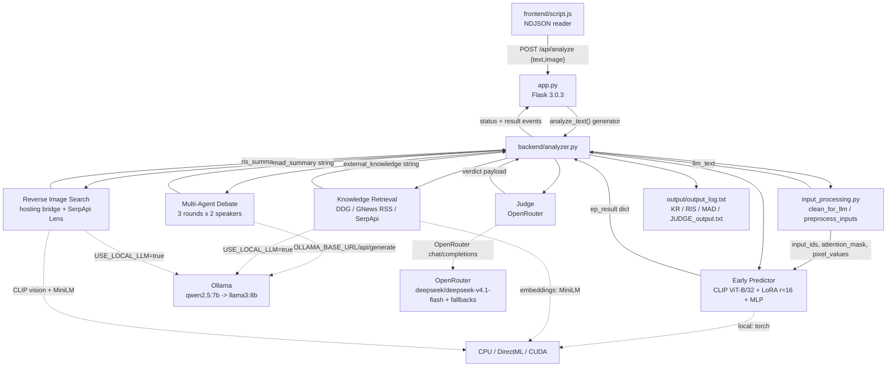
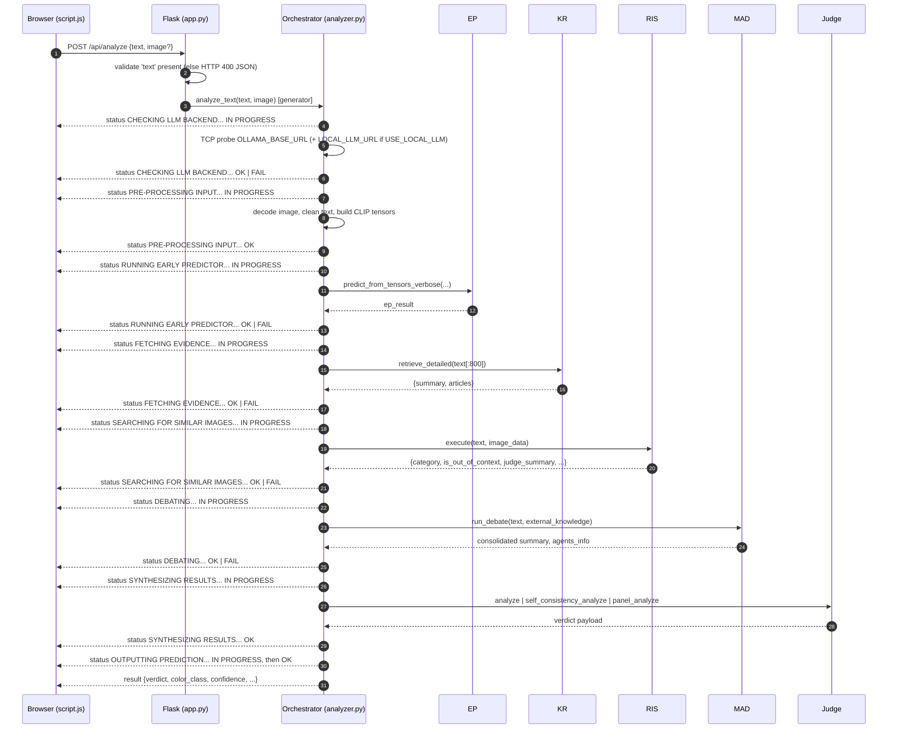

# RAHMAD — Architecture Reference

RAHMAD (**R**etrieval-**A**ugmented **H**ybrid **M**ulti-**A**gent **D**ebate) is a fake-news detection system: a Flask backend plus a single-page dashboard that classifies a news article (optionally with an image) into one of eight misinformation categories and returns a confidence score, a justification, key facts, and supporting links.

This document is the architecture reference for an engineer taking over the codebase. It covers layers, module contracts, data flow, configuration, failure behaviour, observability, the evaluation harness, and known limitations.

Companion documents, deliberately not duplicated here:

| Document | Purpose |
|---|---|
| `README.md` | Install, configure, and run the app |
| `docs/RAHMAD_COMPREHENSIVE_SYSTEM_DOCUMENTATION.md` | Exhaustive capability and operations narrative (prompt-level detail, full per-stage prose) |

Everything below was read out of the source tree. Where a number appears, the file it came from is named. Anything that could not be established from code is not stated.

---

## 1. Purpose and scope

**What the system does.** Given `text` (article headline and/or body) and an optional `image` (base64 data-URL or HTTP URL), `POST /api/analyze` streams progress events and returns one verdict from a fixed taxonomy: `SATIRE OR PARODY`, `FALSE CONNECTION`, `MISLEADING CONTENT`, `IMPOSTER CONTENT`, `MANIPULATED CONTENT`, `FABRICATED CONTENT`, `CREDIBLE`, `INCONCLUSIVE`.

**How it is deployed.** One Python process (`app.py`, Flask 3.0.3, bound to `127.0.0.1:5000` with `debug=True`) serving one static SPA. Local compute: PyTorch/CLIP, two sentence-embedding stages, and an Ollama-served LLM for the debate. Remote compute: OpenRouter for the final adjudication, SerpApi for Google Lens.

**Scope of this document.** Runtime architecture and contracts: what each module is responsible for, what it consumes and produces, how it fails, how it is configured, how it is observed and evaluated. Out of scope: how the Early Predictor was trained, how the evaluation datasets were assembled, and prompt-wording rationale beyond what the contract requires.

**Terminology used throughout.**

| Abbreviation | Expansion | Primary file |
|---|---|---|
| EP | Early Predictor (CLIP + LoRA + MLP) | `model/early_predictor.py` |
| KR | Knowledge Retrieval | `model/knowledge_retrieval.py` |
| RIS | Reverse Image Search | `model/reverse_image_search.py` |
| MAD | Multi-Agent Debate | `model/mad_orchestrator.py`, `model/mad_agent.py` |
| CJM | Chief Judicial Magistrate (the Judge) | `model/judge.py` |

---

## 2. Mental model

RAHMAD is an **evidence-assembly pipeline with a single decision point**. Each module contributes a text artefact and nothing more: EP contributes a calibrated-looking scalar prior, KR contributes a fact outline built from whitelisted news sources, RIS contributes a visual-provenance finding, and MAD contributes a structured adversarial transcript. None of these stages can veto, short-circuit, or skip another — `pass_to_agents` is hardcoded `True` in `EarlyPredictor._build_verdict()` — and the only component that converts evidence into a verdict is the Judge, which receives all four artefacts as a single prompt and reasons over them under a nine-principle constitution. The architecture therefore optimises for *evidence quality and contradiction surfacing* rather than for early exit, which is why a full run costs roughly nine local LLM generations plus one to five cloud calls even when the EP is already confident.

---

## 3. System architecture

### 3.1 Layered view

| Layer | Components | Responsibility |
|---|---|---|
| Presentation | `frontend/index.html`, `styles.css`, `script.js` | Input form, image preview, live step tracker, verdict card, evidence links, reasoning panel |
| HTTP | `app.py` | Serve `/` and `/res/<path>`, validate `POST /api/analyze`, stream NDJSON |
| Orchestration | `backend/analyzer.py` (`analyze_text`) | Lazy model loading, stage sequencing, per-stage error containment, artefact hand-off, logging |
| Pre-processing | `backend/input_processing.py` | Two-branch split: cleaned full text for LLMs, lead text + 224×224 tensor for CLIP |
| Evidence modules | `model/early_predictor.py`, `model/knowledge_retrieval.py`, `model/reverse_image_search.py` | Produce the three non-debate evidence artefacts |
| Debate | `model/mad_orchestrator.py`, `model/mad_agent.py`, `model/shared_memory.py`, `model/llm_client.py` | Produce a structured adversarial transcript and its synthesis |
| Adjudication | `model/judge.py` | Single-pass, self-consistency, or three-specialist panel adjudication plus a Python-level constitutional guardrail |
| Persistence / observability | `backend/pipeline_logger.py`, module-level `save_*_log()` methods | Five forensic logs under `output/` |
| Evaluation | `testing/*.py` | Unit, integration, and evaluation runners with module-output caches |

### 3.2 Component diagram



### 3.3 Request lifecycle



Latency is dominated by MAD: nine sequential Ollama generations (`summarize_context`, `assign_profiles`, six arguments, `consolidate_discourse`), each with a 180 s per-model timeout in `LLMClient.generate()`. KR adds up to four search tiers plus a 25 s Scrapy subprocess timeout. The Judge adds one 45 s-timeout request per model attempt. There is no global pipeline deadline.

### 3.4 NDJSON event contract

`app.py` wraps the generator as `Response(generate(), mimetype='application/x-ndjson')` and serialises each yielded dict as one JSON object followed by `\n`.

**Two event types only.**

```json
{"type": "status", "step": "DEBATING...", "status": "IN PROGRESS"}
{"type": "result", "data": { "verdict": "...", "color_class": "...", "confidence": "...", "justification": "...", "reasoning": "...", "key_facts": ["..."], "links": [...], "ep_signal": {...} }}
```

**Step vocabulary.** The frontend pre-draws these eight lines as pending (`streamSteps` in `frontend/script.js`) and matches incoming events by exact `step` string.

| # | `step` | Terminal statuses the backend can emit | Notes |
|---|---|---|---|
| 0 | `CHECKING LLM BACKEND...` | `OK`, `FAIL` | Preflight TCP probe; `FAIL` does not abort the run |
| 1 | `PRE-PROCESSING INPUT...` | `OK` | Always `OK`, including when it silently degrades to text-only |
| 2 | `RUNNING EARLY PREDICTOR...` | `OK`, `FAIL` | `FAIL` when no image is supplied or EP raises |
| 3 | `FETCHING EVIDENCE...` | `OK`, `FAIL` | `FAIL` on any KR exception |
| 4 | `SEARCHING FOR SIMILAR IMAGES...` | `OK`, `FAIL` | `FAIL` when no image is supplied or RIS raises |
| 5 | `DEBATING...` | `OK`, `FAIL` | `FAIL` only if the orchestrator raises; LLM errors are contained inside the transcript |
| 6 | `SYNTHESIZING RESULTS...` | `OK` | `FAIL` is never emitted, including on Judge failure |
| 7 | `OUTPUTTING PREDICTION...` | `OK` | Emitted only on the success path |

**Contract guarantees and gaps.**

- `IN PROGRESS` is always emitted before the matching terminal status for steps 0–5, and for step 6/7 on the success path.
- Exactly one `result` event is emitted per request.
- If the Judge raises, the orchestrator emits **no** terminal status for `SYNTHESIZING RESULTS...` and **no** `OUTPUTTING PREDICTION...` events; it jumps straight to a `result` with `INCONCLUSIVE` / `0.0%`. The UI therefore leaves those two lines pending while still rendering the verdict.
- `SKIPPED` is handled by the frontend but never emitted by the backend; a skipped stage is reported as `FAIL`.
- The frontend creates a new log line for any `step` string it does not recognise, so adding a step server-side is backward-compatible with an older page.

---

## 4. Module reference

### 4.1 Pre-processing — `backend/input_processing.py`

| Aspect | Detail |
|---|---|
| Responsibility | Split raw input into two branches: a cleaned full text for every LLM prompt, and a short "lead text" plus tensors for CLIP |
| Entry points | `clean_for_llm(raw_text)`, `extract_and_clean_lead_text(raw_text)`, `tokenize_text(...)`, `process_image(...)`, `preprocess_inputs(raw_text, image)` |
| Inputs | Raw article string; PIL image in RGB |
| Outputs | `clean_for_llm` → `str`; `preprocess_inputs` → `{llm_text, lead_text, input_ids[1,77], attention_mask[1,77], pixel_values[1,3,224,224]}` |
| Key behaviour | `lead_text` is headline plus first body sentence (`" ".join(lines[:2])`), cleaned and truncated to CLIP's 77-token window. `llm_text` is the full cleaned text and is what the Judge sees. Images are resized/cropped to 224×224 by the CLIP processor |
| Config | None; `_MAX_TEXT_LEN = 77` is a module constant |
| Failure behaviour | No internal try/except. If `preprocess_inputs` raises, the orchestrator catches it, falls back to `clean_for_llm`, and sets `has_clip = False` |

The lead-text design is the reason EP and Judge can disagree about the same article: EP never sees more than roughly one sentence, while the Judge sees up to 6 000 characters.

### 4.2 Early Predictor (EP) — `model/early_predictor.py`

| Aspect | Detail |
|---|---|
| Responsibility | Fast multimodal prior over the article; strictly advisory |
| Entry points | `EarlyPredictor(...)`, `.predict(raw_text, image)`, `.predict_from_tensors(...)`, `.predict_from_tensors_verbose(...)` (used by the orchestrator so CLIP embeddings can be logged) |
| Model | Frozen `openai/clip-vit-base-patch32` + PEFT LoRA `r=16`, `lora_alpha=32`, `lora_dropout=0.1`, targeting `text_projection`, `visual_projection`, and the `q_proj`/`v_proj` of both encoders (`data_processing/early_predictor_output/lora_adapter/adapter_config.json`). Text and image embeddings (512 each) are concatenated to 1024 and passed through `Linear(1024→1) + Sigmoid` |
| Artifacts | `data_processing/early_predictor_output/{lora_adapter,mlp_head.pt,processor}`; falls back to `archive/data_processing/early_predictor_output` if the primary path is absent (`_ARTIFACTS_DIR`). All three are validated at construction and raise `FileNotFoundError` if missing |
| Decision rule | `p >= 0.60` → `FAKE`; `p <= 0.40` → `REAL`; otherwise `UNCERTAIN`. `confidence` is `f"{p*100:.1f}%"` — the probability itself, not a margin |
| Output | `{probability, label, confidence, color_class, pass_to_agents: True}`; `color_class` is `manipulated` / `real` / `inconclusive` |
| Device | Auto-selects DirectML → CUDA → CPU |
| Config | No env vars; thresholds are constructor parameters defaulting to the module constants |
| Failure behaviour | Construction failures and inference exceptions propagate. The orchestrator pre-seeds `ep_result` with the neutral no-image signal, so an EP exception degrades to `{probability 0.5, label UNKNOWN, confidence "N/A"}` rather than aborting |

The model is loaded once and cached by `_get_predictor()` in the orchestrator; the first request pays the load cost.

### 4.3 Knowledge Retrieval (KR) — `model/knowledge_retrieval.py`, `backend/news_spider.py`, `backend/domain_whitelist.py`

| Aspect | Detail |
|---|---|
| Responsibility | Retrieve whitelisted news coverage of the claim, keep only semantically relevant passages, and synthesise a fact outline for MAD and the Judge |
| Entry points | `KnowledgeRetriever(similarity_threshold=0.35, max_age_years=3, max_articles=5)`, `.retrieve_detailed(claim)` → `{claim, articles, summary, llm_used}`; internals `search_claim`, `filter_domains`, `metadata_filter`, `semantic_filter`, `synthesize`, `save_kr_log` |
| Query construction | The orchestrator passes `input_text[:800]`. `search_claim` then takes the first non-empty line as the query, strips wire datelines (`CITY, Sept 9 (Reuters) -`), and truncates to the first sentence if over 140 characters |
| Retrieval tiers | ① DuckDuckGo HTML endpoint; ② `DDGS.news()` if too few URLs; ③ Google News RSS (used when DDG returns bot-detection/ratelimit), with `googlenewsdecoder` resolving redirect tokens; ④ SerpApi Google News with social-site exclusions. Social-media domains are filtered out at every tier |
| Whitelist | `VERIFIED_DOMAINS` in `backend/domain_whitelist.py` — 76 entries; `is_domain_whitelisted(url)` matches exact host or `.<domain>` subdomain after stripping `www.` |
| Extraction | `backend/news_spider.py` (`NewsArticleSpider`) runs in a temp directory via a Scrapy subprocess: 8 concurrent requests, `DOWNLOAD_TIMEOUT=10`, `ROBOTSTXT_OBEY=False`, subprocess timeout 25 s. Extraction is `trafilatura` first, BeautifulSoup `<p>` fallback second; articles shorter than 100 characters are dropped. Un-extractable whitelisted URLs are retained as headline-only references resolved from search metadata, page metadata, or the URL slug |
| Relevance filter | Paragraph chunks > 50 characters embedded with `all-MiniLM-L6-v2`; up to 3 chunks per article at cosine ≥ 0.35 survive |
| Synthesis | Prompt-constrained fact outline (entities, amounts/rulings, timeline) at `temperature=0.2`, `max_tokens=1200`, `timeout=120`. Falls back to concatenated raw snippets if every model in the chain fails |
| Config | `USE_LOCAL_LLM`, `LOCAL_LLM_URL`, `LOCAL_LLM_MODEL`, `LOCAL_LLM_MODEL_FALLBACK`, `OPENROUTER_API_KEY`, `OPENROUTER_MODEL`, `OPENROUTER_MODEL_FALLBACK`, `SERPAPI_API_KEY` (tier ④) |
| Failure behaviour | Returns a summary string rather than raising in the normal cases: no URLs, no whitelisted URLs, no snippet above threshold each produce an explanatory summary and a `failed - *` status in `KR_output.txt`. Only unexpected exceptions reach the orchestrator, which marks `FETCHING EVIDENCE...` as `FAIL` and passes an empty `external_knowledge` |

### 4.4 Reverse Image Search (RIS) — `model/reverse_image_search.py`

| Aspect | Detail |
|---|---|
| Responsibility | Establish visual provenance: is the image authentic to the claimed event, recycled from another event, generic, or undeterminable |
| Entry point | `ReverseImageSearchPipeline(visual_threshold=0.68, semantic_threshold=0.0).execute(claim_text, image_url)`; also `.log_skipped(...)`, `.save_ris_log(...)` |
| Stage 1 — hosting | The image is published to a temporary host so SerpApi can fetch it. Five tiers in order: ImgBB (if `IMGBB_API_KEY`), freeimage.host, tmpfiles.org, envs.sh, catbox.moe. Base64 data-URLs and local file paths are uploaded; HTTP(S) URLs are used directly as the Lens query |
| Stage 2 — Lens | `serpapi.GoogleSearch` with `engine="google_lens"`; returns candidate matches (title, source, link, thumbnail) |
| Stage 3 — CLIP filter | Thumbnails downloaded (10 s timeout) and embedded with CLIP vision; cosine ≥ 0.68 survives. Purely image-to-image, so language-agnostic |
| Stage 4 — MiniLM filter | Claim vs. candidate **title** cosine ≥ 0.0 — i.e. permissive by design; the scores are recorded but effectively only empty titles fail. Rationale: a hard semantic gate discards valid cross-lingual and archival matches, and the Visual Agent can weigh weak matches itself |
| Context fallback | `candidate_contexts = semantically_filtered if semantically_filtered else visually_filtered` — visual matches are never lost to the semantic stage |
| Stage 5 — Visual Agent | Local Ollama (or OpenRouter when `USE_LOCAL_LLM=false`) classifies into `Authentic Context / Matching Event`, `Out-of-Context (Misattributed / Recycled)`, `Generic / Illustrative Imagery`, `Inconclusive / Insufficient Evidence`, and returns `is_out_of_context`, `confidence`, `summary`, `judge_summary` |
| Output | `{status, category, is_out_of_context, confidence, visual_agent_summary, judge_summary, matches, search_url, llm_used}` |
| Config | `SERPAPI_API_KEY`, `IMGBB_API_KEY`, `USE_LOCAL_LLM`, `LOCAL_LLM_URL`, `LOCAL_LLM_MODEL(_FALLBACK)`, `OPENROUTER_*` |
| Failure behaviour | Missing SerpApi key or zero Lens results → `status: "failed"`, no exception. Zero CLIP matches → `status` stays `"success"` with category `Unknown`. Visual Agent unreachable → `Inconclusive / Insufficient Evidence` with `is_out_of_context: false`. Any unhandled exception → `status: "failed"` plus an error summary, logged to `RIS_output.txt` |

### 4.5 Multi-Agent Debate (MAD) — `model/mad_orchestrator.py`, `model/mad_agent.py`, `model/shared_memory.py`, `model/llm_client.py`

| Aspect | Detail |
|---|---|
| Responsibility | Stress-test the claim through structured adversarial argument so the Judge sees both the strongest defence and the strongest attack |
| Entry point | `OrchestratorAgent().run_debate(article, external_knowledge)` → `(consolidated_summary, agents_info)`; internals `summarize_context`, `assign_profiles`, `consolidate_discourse`, `save_debate_log` |
| Shape | 6 agents (3 Real News, 3 Fake News) × 3 stages. Each stage runs one Real then one Fake speaker; each agent speaks exactly once, so 6 arguments total. Stage names: `Round 1: First Speakers`, `Round 2: Second Speakers`, `Round 3: Third Speakers` |
| Context construction | `summarize_context` sends the **full raw article** (not the cleaned `llm_text`) and asks for core claims plus political/social framing analysis; the KR summary is appended **verbatim** rather than re-summarised, to avoid fact loss |
| Profiles | `assign_profiles` asks the LLM for exactly 6 short role titles parsed from a JSON array, with a hardcoded six-role fallback (`Investigative Journalist`, `Forensic Data Analyst`, `Political Fact-Checker`, `Media Context Analyst`, `Public Records Specialist`, `Source Verification Expert`) |
| Memory | `SharedMemoryBank` holds the article, the context summary, and a per-stage argument list; `get_formatted_history()` serialises article + context + all arguments so far into every prompt, so prompts grow monotonically |
| Speaker discipline | `mad_agent.py` injects role-specific structure (introduction / arguments / summary / conclusion for First; rebuttal + *new* evidence for Second; whip-style weighing for Third) plus seven critical rules (anti-regurgitation, concise summaries, domain specialisation, factual-veracity focus, no policy debate, bias analysis, aggressive defence) |
| Third Speaker override | The Third Speaker prompt carries a `CRITICAL OVERRIDE` exempting it from rule 1 (anti-regurgitation) and rule 3 (domain specialisation): it must weigh the existing record and is barred from introducing new evidence |
| LLM access | All calls go through `LLMClient.generate()` → `POST {OLLAMA_BASE_URL}/api/generate` with `stream: false`. There is no cloud path. Primary `LOCAL_LLM_MODEL` (`.env.example` sets `qwen2.5:7b`; the code default is the first fallback entry, `llama3:8b`), fallback chain from `LOCAL_LLM_MODEL_FALLBACK`, 180 s timeout per attempt |
| Output | `consolidated` synthesis string (3-part neutral analysis of both sides and the clash points) plus `agents_info` for logging |
| Failure behaviour | `LLMClient.generate()` never raises: on exhaustion it returns a bracketed error string such as `[Error calling Ollama API (qwen2.5:7b): 404 ... - Response: ...]` or `[Error connecting to Ollama (qwen2.5:7b): ...]`. The debate therefore "succeeds" with an error-laden transcript and `DEBATING...` reports `OK`; only an exception from the orchestrator itself yields `FAIL` |

The design rationale for local-only inference is cost and rate limits: a full run issues nine sequential generations, and a cloud model would be billed nine times per article and could refuse politically sensitive topics.

### 4.6 Chief Judicial Magistrate (Judge) — `model/judge.py`

| Aspect | Detail |
|---|---|
| Responsibility | Convert all evidence into one taxonomy verdict with confidence, justification, key facts, and reasoning |
| Entry points | `Judge(api_key=None, model_name=None, temperature=0.2, max_tokens=4096)`, `.analyze(...)`, `.self_consistency_analyze(..., n=3, sc_temperature=0.7)`, `.panel_analyze(...)`, `.save_judge_log(...)` |
| Provider | OpenRouter OpenAI-compatible endpoint `https://openrouter.ai/api/v1/chat/completions`, 45 s timeout per attempt, `reasoning: {"effort": "low"}` to stop reasoning models from spending the whole budget in `message.reasoning` |
| Model chain | `[JUDGE_MODEL or OPENROUTER_MODEL or "deepseek/deepseek-v4.1-flash"] + JUDGE_MODEL_FALLBACK or OPENROUTER_MODEL_FALLBACK`, deduplicated at call time. `.env.example` ships `deepseek/deepseek-v4.1-flash`, `z-ai/glm-5.3-flash`, `stealth/space-bunny-alpha`, `deepseek/deepseek-v4-flash-0731`; the code default fallback list is different (`nvidia/nemotron-3-nano-omni-30b-a3b-reasoning:free`, `inclusionai/ling-3.0-flash:free`, `poolside/laguna-m.1:free`) |
| Modes (`JUDGE_MODE`) | `single` (default) — one pass; `self_consistency` — n=3 parallel paths at temperature 0.7, majority vote, confidence averaged over agreeing runs, `sc_votes` returned; `panel` — three parallel specialists (`_FACT_CHECKER_PROMPT`, `_LINGUIST_PROMPT`, `_LOGICIAN_PROMPT`, each emitting a 1–10 risk score) followed by a sequential Chief synthesizer (`_CHIEF_JUDGE_PROMPT`) |
| Constitution | Nine principles P1–P9 in `_SYSTEM_PROMPT`. P5 sets confidence calibration; P6 makes EP advisory; P7 makes KR the authoritative factual source; **P8** governs visual provenance and contains the evidentiary hierarchy — verified KR fact-checking outranks automated RIS heuristics, while an authentic photo never certifies uncorroborated text; P9 admits debate findings |
| Reasoning protocol | Seven mandatory steps: domain orientation, claim extraction, internal consistency, framing/style, source attribution, multimodal/multi-agent integration, self-critique |
| Output parsing | Five-stage parser: ① direct `json.loads`; ② scan for a brace-balanced object containing `"verdict"`; ③ reverse greedy brace extraction from the last `"verdict"`; ④ auto-close truncated JSON (unbalanced braces/quotes); ⑤ regex field extraction from prose. Verdict strings are normalised through a trigger table (e.g. `MISLEADING` → `MISLEADING CONTENT`) and unknown values fall back to `INCONCLUSIVE` |
| Python guardrail | `_enforce_constitutional_guardrails()` post-processes any `CREDIBLE` verdict when `ris_summary` contains `out-of-context imagery detected: yes`: it checks whether the Judge's own `reasoning`/`justification` both acknowledge the visual finding and cite external corroboration; if not, it rewrites the verdict to `FALSE CONNECTION` and appends an explanatory note |
| Output | `{verdict, color_class, confidence, justification, reasoning, key_facts, links, ep_signal}` (+ `sc_votes` in self-consistency) |
| Failure behaviour | Any API or parse failure returns a structured fallback: `INCONCLUSIVE`, `0.0%`, justification containing the error, one key fact pointing at `OPENROUTER_API_KEY` and connectivity. Missing API key raises `ValueError` at construction, which the orchestrator converts into the same structured fallback via its exception handler |

Two details worth knowing before touching this file: the guardrail's `external_knowledge` parameter is accepted but never read — the decision is made purely from phrase matching over the Judge's own output; and the class docstring still says `max_tokens` defaults to 1024 while the constructor default is 4096.

### 4.7 Orchestrator — `backend/analyzer.py`

| Aspect | Detail |
|---|---|
| Responsibility | Own the run: lazy singletons, stage sequencing, per-stage error containment, artefact assembly, logging |
| Entry point | `analyze_text(input_text, image_data=None)` — a **generator** (its docstring still says "return a dict") |
| Lazy singletons | `_get_predictor`, `_get_judge`, `_get_retriever`, `_get_ris_pipeline`, `_get_mad_orchestrator` |
| Image decoding | `_decode_image` accepts `data:` base64 or `http(s)://`; anything else returns `None` |
| Preflight | `_preflight_local_llm()` TCP-connects (1.5 s) to `OLLAMA_BASE_URL`, and to `LOCAL_LLM_URL` when `USE_LOCAL_LLM=true` and it is a different host:port |
| RIS gating | RIS runs only when `has_clip` and the image string starts with `data:`, `http://`, or `https://` |
| Artefact assembly | Builds `ris_summary` from `judge_summary`/`visual_agent_summary` plus category, OOC flag, confidence and an entailment-scope disclaimer; converts up to 6 KR articles into `links`; attaches `ep_signal` |
| Config | `JUDGE_MODE`, `USE_LOCAL_LLM`, `OLLAMA_BASE_URL`, `LOCAL_LLM_URL` |
| Failure behaviour | Every stage is individually wrapped; the run continues with whatever artefacts exist. A Judge exception ends the stream with a synthetic `INCONCLUSIVE` result (see §3.4 for the status-event gap) |

### 4.8 Web tier and frontend — `app.py`, `frontend/`

| Aspect | Detail |
|---|---|
| Routes | `GET /` → `frontend/index.html`; `GET /res/<path:filename>` → `res/`; `POST /api/analyze` → NDJSON stream |
| Validation | `request.get_json()`; missing body or missing `text` → HTTP 400 `{"error": "No text provided"}` |
| CORS | `flask_cors.CORS(app)` — permissive, which is why the SPA can hardcode `http://127.0.0.1:5000/api/analyze` |
| Frontend behaviour | Pre-draws the eight steps as pending; reads the stream with `response.body.getReader()` and a manual newline buffer; updates the matched line in place; on `result`, renders verdict (with a `<br>` after the first space), confidence, justification (markdown-bold converted), key facts, up to 6 links, and a collapsible reasoning panel |
| Not rendered | `ep_signal` is returned but never displayed; there is no UI for EP probability |

---

## 5. End-to-end data flow of one analysis

1. **Input.** Browser posts `{text, image}`. `image` is a data-URL (from the file input) or an HTTP URL.
2. **Preflight.** Two or three TCP probes. Result recorded in log section `[0]`; `FAIL` is informational only.
3. **Pre-processing.** `_decode_image` → PIL RGB (or `None`). `preprocess_inputs` → `llm_text` (full, cleaned) and CLIP tensors from `lead_text` (headline + first sentence). On any failure: `llm_text = clean_for_llm(text)`, `has_clip = False`.
4. **EP.** If `has_clip`, `predict_from_tensors_verbose` returns `ep_result` plus `text_embeds`, `image_embeds`, and the fused 1024-d vector, all logged. Otherwise `ep_result` stays `{probability 0.5, label UNKNOWN, confidence "N/A", pass_to_agents True}`.
5. **KR.** `retrieve_detailed(input_text[:800])` → `external_knowledge` (fact outline or explanatory failure string) and `articles` (used later for `links`).
6. **RIS.** If an image exists, `execute(input_text, image_data)` → `judge_summary`, `category`, `is_out_of_context`, `confidence`. The orchestrator wraps these into a block with an explicit entailment-scope disclaimer ("visual provenance confirms only that the media file is genuine…").
7. **MAD.** `run_debate(input_text, external_knowledge)` — note the raw text, not `llm_text` — produces the consolidated synthesis. The full transcript is written to `MAD_output.txt` but only the synthesis reaches the Judge.
8. **Judge.** One of the three modes, with `llm_text`, `ep_result`, `external_knowledge`, `ris_summary`, `mad_summary`. Guardrail applied. `links` and `ep_signal` attached.
9. **Response.** Two closing status events plus the `result` object.

### 5.1 What the Judge actually receives

The user message is built by `Judge._build_user_message()` from `_USER_TEMPLATE`; the article is truncated to `_MAX_TEXT_CHARS = 6000`:

```text
=== KNOWLEDGE RETRIEVAL EVIDENCE ===
{external_knowledge | "No external text knowledge provided."}

Note: This is verified external ground-truth evidence retrieved from reputable
whitelisted news outlets via semantic similarity filtering.

=== REVERSE IMAGE SEARCH EVIDENCE ===
{ris_summary | "No Reverse Image Search data provided."}

=== MULTI-AGENT DEBATE SUMMARY ===
{mad_summary | "No Multi-Agent Debate data provided."}

=== EARLY PREDICTOR SIGNAL ===
Label       : {ep_label}
Probability : {ep_prob:.4f}  (0.0 = Real, 1.0 = Fake)
Confidence  : {ep_confidence}

Note: This is a preliminary multimodal signal from a CLIP+LoRA model — treat it
as evidence, not as a definitive answer. You must run your own full reasoning
protocol before reaching a verdict.

=== ARTICLE TEXT ===
{llm_text[:6000]}

Now work through your 7-step reasoning protocol and return your verdict as a
JSON object.
```

`ris_summary` is not the raw RIS output. The orchestrator composes it as:

```text
--- REVERSE IMAGE SEARCH FINDINGS ---
Category: <category>
Out-of-Context Imagery Detected: YES (Decontextualized / Misattributed) | NO (Authentic Context / Non-Deceptive)
Confidence: <High | Medium | ...>
Entailment Scope: Authentic visual provenance confirms only that the media file is genuine and not recycled from an unrelated event; it does NOT independently corroborate unverified claims or speculative character attributions in the caption/text.
Executive Evidence Summary for Judge:
<judge_summary>
```

Consequences worth remembering:

- The Judge never sees individual KR snippets, URLs, similarity scores, or the KR article list — only the synthesised outline.
- The Judge never sees the debate transcript — only the consolidation. Individual agent profiles and arguments live in `MAD_output.txt`.
- If RIS returns `status: "failed"` (e.g. Lens returned nothing), the orchestrator does **not** build a block, so the Judge sees the neutral placeholder and cannot tell "no evidence" from "search failed".
- Only on a raised exception does `ris_summary` contain an explicit error string.

---

## 6. Configuration

### 6.1 Environment variables

Loaded by `load_dotenv()` in `app.py`, `model/judge.py`, and `model/llm_client.py`. Defaults below are the values used when the variable is unset.

| Variable | Code default | Consumed by | Effect |
|---|---|---|---|
| `USE_LOCAL_LLM` | `false` | KR, RIS, preflight | Route KR synthesis and RIS Visual Agent to the local endpoint instead of OpenRouter |
| `LOCAL_LLM_URL` | `http://localhost:11434/v1/chat/completions` | KR, RIS, preflight | OpenAI-compatible chat-completions endpoint for local synthesis |
| `LOCAL_LLM_MODEL` | first entry of `LOCAL_LLM_MODEL_FALLBACK` | KR, RIS, MAD | Primary local model id |
| `LOCAL_LLM_MODEL_FALLBACK` | `llama3:8b` | KR, RIS, `LLMClient` | Ordered local fallback chain (comma-separated) |
| `OLLAMA_BASE_URL` | `http://localhost:11434` | MAD, preflight | Base URL for `POST /api/generate` |
| `OPENROUTER_API_KEY` | — (required) | Judge, KR, RIS | Bearer token; `Judge.__init__` raises if absent |
| `OPENROUTER_MODEL` | `nvidia/nemotron-3-nano-omni-30b-a3b-reasoning:free` | KR, RIS | Primary cloud synthesis / visual-agent model |
| `OPENROUTER_MODEL_FALLBACK` | comma-separated list | KR, RIS | Cloud fallback chain |
| `JUDGE_MODEL` | `deepseek/deepseek-v4.1-flash` | Judge | Primary judicial model (also read as `OPENROUTER_MODEL` fallback) |
| `JUDGE_MODEL_FALLBACK` | see §4.6 | Judge | Judicial fallback chain; duplicates of the primary are dropped |
| `JUDGE_MODE` | `single` | Orchestrator | `single` \| `self_consistency` \| `panel` |
| `SERPAPI_API_KEY` | — (required for RIS) | RIS, KR tier ④ | Google Lens and Google News |
| `IMGBB_API_KEY` | — (optional) | RIS | Preferred image host; without it the free-host chain is used |

`.env.example` ships `USE_LOCAL_LLM=true` and `LOCAL_LLM_URL=http://your-url-here`, i.e. the intended production configuration is fully local for KR/RIS synthesis. The code default is the opposite, so an unset environment silently falls back to OpenRouter for those two stages — and then fails to synthesise if no OpenRouter key exists (KR degrades to raw snippets; RIS degrades to `Inconclusive`).

### 6.2 Compute routing

| Stage | Runs on |
|---|---|
| Pre-processing, EP, KR search/scraping, CLIP + MiniLM filters | Local (CPU / DirectML / CUDA) |
| KR synthesis, RIS Visual Agent | Local Ollama if `USE_LOCAL_LLM=true`, else OpenRouter |
| MAD (9 generations) | Local Ollama, always — `LLMClient` has no cloud path |
| Judge (all modes) | OpenRouter, always |

Note the split endpoint: MAD talks to `OLLAMA_BASE_URL/api/generate` (native Ollama API), while KR and RIS talk to `LOCAL_LLM_URL/v1/chat/completions` (OpenAI-compatible). Both default to port 11434, but they are configured independently and the preflight probes both when they differ.

### 6.3 Hardcoded thresholds

| Constant | Value | Location |
|---|---|---|
| EP FAKE / REAL thresholds | 0.60 / 0.40 | `model/early_predictor.py` |
| EP text window | 77 tokens | `model/early_predictor.py`, `backend/input_processing.py` |
| EP image size | 224 × 224 | `backend/input_processing.py` (CLIP processor) |
| KR similarity threshold | 0.35 | `KnowledgeRetriever.__init__` |
| KR max articles / max age | 5 / 3 years | `KnowledgeRetriever.__init__` |
| KR chunks per article | 3 | `semantic_filter` |
| RIS CLIP threshold | 0.68 | `ReverseImageSearchPipeline.__init__` |
| RIS MiniLM threshold | 0.0 | `ReverseImageSearchPipeline.__init__` |
| Judge article cap | 6 000 chars | `model/judge.py` |
| Judge temperature / max tokens | 0.2 / 4096 | `Judge.__init__` |
| Self-consistency n / temperature | 3 / 0.7 | `self_consistency_analyze` defaults |
| Links surfaced | 6 | `backend/analyzer.py` |

None of these is environment-configurable; changing them means editing code.

---

## 7. Failure modes and degradation matrix

Every stage is contained, so a single failure degrades quality rather than aborting the run. The table states what actually happens, not what ideally should.

| Condition | Detection | Behaviour | User-visible signal |
|---|---|---|---|
| Ollama down | Preflight TCP fails | `CHECKING LLM BACKEND... FAIL`; run continues | Step 0 marked failed |
| Ollama down, `USE_LOCAL_LLM=true` | Same | KR synthesis → concatenated raw snippets; RIS Visual Agent → `Inconclusive / Insufficient Evidence`, `is_out_of_context: false`; MAD → 9 error strings forming the transcript | KR/RIS steps may still report `OK`; only the content degrades |
| Ollama down, MAD | `LLMClient` catches `RequestException` per model | Debate transcript is error strings; consolidation is an error string; `DEBATING... OK` | Nothing, unless you read the transcript |
| Ollama slow | 180 s per model attempt, ×2 models, ×9 calls | No global timeout; a single article can block for a long time | Step 5 stays `IN PROGRESS` |
| OpenRouter down / key invalid | `_call_api` exhausts the chain, then raises | Structured fallback: `INCONCLUSIVE`, `0.0%`, error text in justification | `SYNTHESIZING RESULTS...` never terminates; result still arrives |
| OpenRouter returns unparsable text | Five-stage parser fails | Same structured fallback | As above |
| No image supplied | `_decode_image` → `None` | EP neutral `{0.5, UNKNOWN}`; RIS skipped; both steps `FAIL` | Steps 2 and 4 marked failed |
| Image undecodable | Exception inside `_decode_image` | Same as no image (logged warning) | Steps 2 and 4 marked failed |
| `preprocess_inputs` raises | Orchestrator `except` | Falls back to text-only; EP skipped | Step 2 `FAIL`, step 1 still `OK` |
| EP artifacts missing | `FileNotFoundError` at construction | EP step `FAIL`; neutral signal retained | Step 2 `FAIL` |
| SerpApi key missing / quota exhausted | `fetch_results` returns no results | RIS `status: "failed"`; Judge receives the neutral placeholder (not an error) | Step 4 `FAIL` |
| Lens returns matches but none pass CLIP 0.68 | `visually_filtered` empty | RIS reports `status: "success"`, category `Unknown`, OOC `NO`; Judge is told nothing similar was found | Step 4 `OK` |
| Image hosting fails on all five hosts | Upload returns `None` | RIS cannot query Lens; treated as no results | Step 4 `FAIL` |
| KR finds no whitelisted URLs | `filter_domains` empty | Summary explains the failure; `external_knowledge` is a message, not facts | Step 3 `OK` (the module returned normally) |
| KR scraping blocked by every publisher | All articles un-extractable | Whitelisted references preserved as headlines; summary notes the situation | Step 3 `OK`, `links` populated |
| Debate profiles unparsable | `assign_profiles` exception | Hardcoded six-role fallback | None |

---

## 8. Observability

### 8.1 The five logs

All five live in `output/`, are overwritten on each run, and are gitignored (`/output`).

| File | Writer | Contents |
|---|---|---|
| `output/output_log.txt` | `PipelineLogger.save()` | Unified per-stage log (sections listed below), including the full Judge system prompt and user message, the raw model response, and per-module runtimes |
| `output/KR_output.txt` | `KnowledgeRetriever.save_kr_log()` | Claim, backend used, every URL tagged `[WHITELISTED]`/`[FILTERED OUT]`, extracted articles, preserved un-extractable references, semantic snippets with the 0.35 threshold, synthesis output, final status |
| `output/RIS_output.txt` | `ReverseImageSearchPipeline.save_ris_log()` | Search URL, raw Lens matches, per-candidate CLIP similarity with pass/fail against 0.68, MiniLM scores, Visual Agent prompt/response, `judge_summary`, final category and OOC flag |
| `output/MAD_output.txt` | `OrchestratorAgent.save_debate_log()` | Article, context summary, agent roster, every argument tagged by side and stage, consolidated synthesis |
| `output/JUDGE_output.txt` | `Judge.save_judge_log()` | Mode, primary model, fallback chain, runtimes, EP context, whether KR/RIS/MAD were ingested, article text, mode-specific intermediates (panel reports with risk scores / self-consistency vote tally / single-pass CoT), final verdict and key facts |

### 8.2 `pipeline_logger` sections

`PipelineLogger` appends sections to an in-memory buffer and writes it on `save()`:

| Section | Title | Content |
|---|---|---|
| `[0]` | LOCAL LLM BACKEND PREFLIGHT | Each probed URL and its reachability |
| `[1]` | PRE-PROCESSING — INPUT | Raw text preview, image size/mode |
| `[2]` | PRE-PROCESSING — OUTPUT | Runtime, `llm_text`, `lead_text`, tensor shapes with min/max/norm and the first values |
| `[3]` | CLIP ENCODER — OUTPUT (or SKIPPED) | `text_embeds`, `image_embeds`, fused 1024-d summary |
| `[4]` | EARLY PREDICTOR — OUTPUT (or SKIPPED) | Probability, label, confidence, `pass_to_agents`, runtime |
| `[5]` | KNOWLEDGE RETRIEVAL — OUTPUT | Claim, article count, summary |
| `[5B]` | REVERSE IMAGE SEARCH — OUTPUT | Status, category, OOC flag, summary |
| `[5C]` | MULTI-AGENT DEBATE (MAD) — OUTPUT | Summary, agent roster |
| `[6]` | JUDGE (LLM) — INPUT | Full system prompt and full user message |
| `[7]` | JUDGE (LLM) — OUTPUT | Raw response and parsed verdict |
| `SUMMARY` | MODULE RUNTIMES BREAKDOWN | Per-stage and total timings |

The module docstring at the top of `pipeline_logger.py` still lists only sections `[1]`–`[6]` and omits preflight, KR, RIS and MAD; the implementation is ahead of the comment.

Each module also prints ASCII banner blocks to stdout (`=====` headers with step counters), which is the fastest way to watch a run live.

---

## 9. Evaluation harness

### 9.1 Datasets

Held-out CSV splits under `testing/` (gitignored). Each row carries `text`, `label` (0 = Real, 1 = Fake), and `image_path`.

| Dataset | Provenance | Shape |
|---|---|---|
| `test_dataset_fauxtography.csv` | Fauxtography (Zlatkova et al., EMNLP 2019) — Snopes rumour/doctored-image claims | 60 balanced samples (30/30) for Phase 3 |
| `test_dataset_newsclippings.csv` | NewsCLIPpings (Luo et al., EMNLP 2021) — authentic text paired with an unrelated authentic photo | 60 balanced samples (30/30) |
| `test_dataset_combined.csv` | Concatenation, tagged by `source_dataset` | 120 samples (60/60 per source, 60 Real / 60 Fake) |

`testing/test_phase3_evaluation.py::load_test_split(path, n_samples_ablation=60, seed=42)` performs the split, so runs are reproducible given the same CSV.

### 9.2 The seven ablation configurations

Configurations accumulate layers so each contribution can be isolated (`CONFIGS` in `testing/run_phase3_newsclippings_ablation.py`):

1. EP Only
2. Judge Only
3. EP + Judge
4. EP + KR + Judge
5. EP + KR + RIS + Judge
6. EP + KR + MAD + Judge
7. Full RAHMAD (EP + KR + RIS + MAD + Judge)

Binarisation for scoring: `CREDIBLE` → Real (0), every other verdict including `INCONCLUSIVE` → Fake (1) (`run_combined_120_pipeline.py`).

### 9.3 Caching and checkpointing

Each full-pipeline sample costs web searches plus cloud calls, so module outputs are pre-computed once and reused:

- `.cache_kr_*.json`, `.cache_ris_*.json`, `.cache_mad_*.json` — module output strings keyed by sample id. The runners read them instead of re-running KR/RIS/MAD.
- `.checkpoint_*.json` — per-sample result records written after each iteration; a rerun skips completed ids and reprints their stored verdict.

Consequence for interpretation: the ablation varies *what the Judge is given*, not what the modules produce, so ablation results measure adjudication quality over a fixed evidence set.

### 9.4 Reproducing

From the repository root:

```powershell
# 120-sample end-to-end benchmark (needs .env, Ollama, caches or a willingness to wait)
python testing/run_combined_120_pipeline.py

# NewsCLIPpings 7-way ablation (configs 2-6; config 1 and 7 come from the full run)
python testing/run_phase3_newsclippings_ablation.py

# Fauxtography standalone evaluation + ablation
python testing/run_phase3_fauxtography_final.py

# Unit / integration
python -m pytest testing/test_phase1_unit.py
python testing/test_phase2_integration.py
```

`run_combined_120_pipeline.py` hardcodes `PROJECT_ROOT = Path(r"c:\Users\ahmad\Documents\Programming\fyp\RAHMAD")`; on another machine that line must be edited before the script will find the dataset. The Phase 3 scripts derive `PROJECT_ROOT` from `__file__` and are portable.

### 9.5 Recorded results

**End-to-end, 120-sample combined benchmark** (`testing/combined_120_evaluation_results.txt`):

| Metric | Combined (120) | Fauxtography (60) | NewsCLIPpings (60) |
|---|---|---|---|
| Accuracy | 80.00% (96/120) | 88.33% (53/60) | 71.67% (43/60) |
| Real accuracy (specificity) | 76.67% (46/60) | 80.00% (24/30) | 73.33% (22/30) |
| Fake accuracy (sensitivity) | 83.33% (50/60) | 96.67% (29/30) | 70.00% (21/30) |
| Precision | 78.12% | 82.86% | 72.41% |
| Recall | 83.33% | 96.67% | 70.00% |
| F1 | 80.65% | 89.23% | 71.19% |
| Confusion (TP, FP, TN, FN) | (50, 14, 46, 10) | (29, 6, 24, 1) | (21, 8, 22, 9) |

**NewsCLIPpings 7-way ablation, 60 samples** (`testing/final_phase3_newsclippings_evaluation_results.txt`):

| Configuration | Accuracy | Precision | Recall | Specificity | F1 |
|---|---|---|---|---|---|
| 1. EP Only | 50.00% | 50.00% | 30.00% | 70.00% | 37.50% |
| 2. Judge Only | 48.33% | 42.86% | 10.00% | 86.67% | 16.22% |
| 3. EP + Judge | 43.33% | 16.67% | 3.33% | 83.33% | 5.56% |
| 4. EP + KR + Judge | 50.00% | 50.00% | 13.33% | 86.67% | 21.05% |
| 5. EP + KR + RIS + Judge | 73.33% | 75.00% | 70.00% | 76.67% | 72.41% |
| 6. EP + KR + MAD + Judge | 53.33% | 58.33% | 23.33% | 83.33% | 33.33% |
| 7. Full RAHMAD | 73.33% | 71.88% | 76.67% | 70.00% | 74.19% |

Full-pipeline agreement statistics in the same report: Cohen's κ = 0.4667, mean confidence 78.6%. The headline result is that RIS is the decisive layer for cheapfakes — configs without it sit at 43–53%, configs with it at 73%.

**Fauxtography 7-way ablation, 60 samples** (`testing/final_phase3_fauxtography_evaluation_results.txt`):

| Configuration | Accuracy | Precision | Recall | Specificity | F1 |
|---|---|---|---|---|---|
| 1. EP Only | 43.33% | 44.44% | 53.33% | 33.33% | 48.48% |
| 2. Judge Only | 78.33% | 72.97% | 90.00% | 66.67% | 80.60% |
| 3. EP + Judge | 78.33% | 74.29% | 86.67% | 70.00% | 80.00% |
| 4. EP + KR + Judge | 93.33% | 93.33% | 93.33% | 93.33% | 93.33% |
| 5. EP + KR + RIS + Judge | 86.67% | 80.56% | 96.67% | 76.67% | 87.88% |
| 6. EP + KR + MAD + Judge | 95.00% | 93.55% | 96.67% | 93.33% | 95.08% |
| 7. Full RAHMAD | 86.67% | 80.56% | 96.67% | 76.67% | 87.88% |

Full-pipeline κ = 0.7333, mean confidence 81.8%. The report attributes the pre-fix 61.67% ceiling on this dataset to the old P8 guardrail forcing every OOC flag to `FALSE CONNECTION`, which penalised genuine archival photographs; the reasoning-aware guardrail (§4.6) raised Full RAHMAD to 86.67% and Config 5 from 61.67% to 86.67%.

**Note on Fauxtography figures.** The 88.33% above is the Fauxtography subset of the separate 120-sample combined run; the standalone Phase 3 Fauxtography report records 86.67% (52/60) with κ = 0.7333. These are two different runs over the same dataset family, not one number reported twice. Quote whichever the context requires and name the file.

---

## 10. Extension points and known limitations

### Extension points

| Goal | Where to change |
|---|---|
| Add or reorder a pipeline stage | `backend/analyzer.py` — insert a yield pair around the stage; the frontend tolerates unknown step names but must be updated to pre-draw them |
| Change the verdict taxonomy | `_SYSTEM_PROMPT` Section 2, `_VERDICT_RULES` and `_VALID_CLASSES` in `model/judge.py`, plus the CSS colour classes and `color_class` consumers in `frontend/` |
| Add a whitelisted publisher | `VERIFIED_DOMAINS` in `backend/domain_whitelist.py` (exact host or subdomain match) |
| Tune retrieval strictness | `KnowledgeRetriever(similarity_threshold=..., max_articles=..., max_age_years=...)` |
| Tune visual strictness | `ReverseImageSearchPipeline(visual_threshold=..., semantic_threshold=...)` |
| Swap the debate model | `LOCAL_LLM_MODEL` / `LOCAL_LLM_MODEL_FALLBACK`; no code change |
| Add a Judge mode | New `*_analyze()` method plus a branch in `analyzer.py`'s `mode_labels`/dispatch |
| Add a fourth evidence stream | Extend `_USER_TEMPLATE` and `_build_user_message()`; every mode funnels through them |
| Re-target the local backend | `OLLAMA_BASE_URL` (MAD) and `LOCAL_LLM_URL` (KR/RIS) are independent |

### Known limitations

**Dead and stale code.**

- `backend/analyzer_new.py` is a near-duplicate of `analyzer.py` and is imported nowhere. Deleting it is safe.
- `analyze_text()`'s docstring claims it returns a dict; it is a generator.
- `Judge.__init__` docstring says `max_tokens` defaults to 1024; the signature says 4096.
- `Judge._enforce_constitutional_guardrails()` accepts `external_knowledge` and never uses it.
- `pipeline_logger.py`'s module docstring documents sections `[1]`–`[6]` only.

**Architectural constraints.**

- Single local model dependency: MAD has no cloud path, so without Ollama the debate is a transcript of error strings while the UI reports success.
- Sequential MAD: nine blocking generations with a 180 s per-model timeout and no global deadline. Worst case latency is unbounded in practice.
- Growing prompts: `get_formatted_history()` prepends the full article plus the full context summary to every argument, so prompt size grows with each stage.
- EP sees only the lead text: a long, subtly misleading body cannot influence the EP signal by construction.
- `semantic_threshold = 0.0` in RIS is deliberate (cross-lingual and archival matches would otherwise be discarded) but means the MiniLM stage filters almost nothing; the Visual Agent carries the real discrimination.
- `RIS_output.txt` records `matches_count` as `len(semantically_filtered)`, so it can be 0 even when the Visual Agent was given visually-filtered contexts.
- Frontend hardcodes `http://127.0.0.1:5000/api/analyze`; changing the port requires editing `script.js`. CORS is enabled app-wide, which is what makes that work.
- `app.py` runs with `debug=True` — acceptable for a single-user research deployment, not for anything exposed.
- `ep_signal` is returned to the client but never rendered.

**Evaluation caveats.**

- The runners hardcode absolute paths (`run_combined_120_pipeline.py`).
- Ablations reuse cached module outputs, so they measure adjudication, not retrieval.
- `INCONCLUSIVE` is scored as Fake in binarised metrics; a system that abstains is penalised.
- Sample sizes are 60 per dataset — one sample is 1.67 percentage points, so small deltas between configurations are not meaningful.

---

## 11. Where to start reading the code

1. **`app.py`** (56 lines) — the whole HTTP surface. Understand the generator-to-NDJSON wrapping before anything else.
2. **`backend/analyzer.py`** — read `analyze_text()` top to bottom. It is the only place that knows the stage order, the error containment policy, and how artefacts are assembled. Everything else is a leaf module.
3. **`backend/input_processing.py`** — the `llm_text` / `lead_text` split explains most surprising EP-versus-Judge disagreements.
4. **`model/early_predictor.py`** — `_build_verdict()` (static) holds the threshold logic and `predict()` the tensor plumbing; the LoRA/MLP wiring is in `_load_clip_with_lora()` and `_load_mlp()`.
5. **`model/judge.py`** — start at `_SYSTEM_PROMPT` (principles and taxonomy), then `_USER_TEMPLATE`, then `_parse_response()` and `_enforce_constitutional_guardrails()`. The three mode methods are variations on `analyze()`.
6. **`model/knowledge_retrieval.py`** — `retrieve_detailed()` is a readable five-step narrative with print statements at every boundary.
7. **`model/reverse_image_search.py`** — `execute()` first; the four stages are labelled in comments. Read `filter_semantically()` and the `candidate_contexts` fallback together.
8. **`model/mad_orchestrator.py` + `mad_agent.py`** — `run_debate()` is 60 lines; `mad_agent.py` is almost entirely prompt construction.
9. **`frontend/script.js`** — `streamSteps` (lines ~95–103) and the NDJSON reader (~170–235) are the whole integration.
10. **`testing/run_combined_120_pipeline.py`** — the shortest complete example of driving EP + Judge over a dataset without the web layer.

---

## 12. Source map

| Claim area | Verified against |
|---|---|
| Routes, NDJSON wrapping, validation | `app.py` |
| Stage order, status strings, error containment, no-image EP signal, preflight, link formatting | `backend/analyzer.py` |
| Log sections and fields | `backend/pipeline_logger.py`, `output/output_log.txt` |
| Text/image pre-processing, 77-token window, 224×224 | `backend/input_processing.py` |
| EP architecture, thresholds, artifact paths, device selection | `model/early_predictor.py`, `data_processing/early_predictor_output/lora_adapter/adapter_config.json` |
| KR tiers, whitelist count, thresholds, timeouts, synthesis fallback | `model/knowledge_retrieval.py`, `backend/domain_whitelist.py`, `backend/news_spider.py` |
| RIS thresholds, hosting tiers, taxonomy, fallbacks | `model/reverse_image_search.py` |
| MAD structure, prompt rules, Third Speaker override, LLM client behaviour | `model/mad_orchestrator.py`, `model/mad_agent.py`, `model/shared_memory.py`, `model/llm_client.py` |
| Judge constitution, taxonomy, modes, parser, guardrail, model chain | `model/judge.py` |
| Environment variable names and defaults | `.env.example`, `model/judge.py`, `model/knowledge_retrieval.py`, `model/reverse_image_search.py`, `model/llm_client.py`, `backend/analyzer.py` |
| Evaluation numbers | `testing/combined_120_evaluation_results.txt`, `testing/final_phase3_newsclippings_evaluation_results.txt`, `testing/final_phase3_fauxtography_evaluation_results.txt` |
| Ablation definitions, caching, checkpointing | `testing/run_phase3_newsclippings_ablation.py`, `testing/run_combined_120_pipeline.py`, `testing/test_phase3_evaluation.py` |
