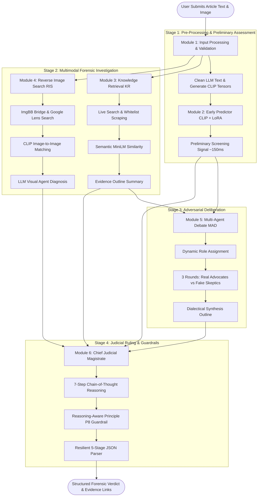

# RAHMAD System: Comprehensive Architecture, Capabilities, and Operations Guide
**Reliable Automated Hybrid Multi-Agent Detection**
*A Defense-in-Depth, Multimodal Framework for Automated Fake News and Cheapfake Verification*

---

## Table of Contents
1. [Executive Summary & The Core Challenge](#1-executive-summary--the-core-challenge)
2. [High-Level Architecture & End-to-End Pipeline](#2-high-level-architecture--end-to-end-pipeline)
3. [Module 1: Input Processing & Validation](#3-module-1-input-processing--validation)
4. [Module 2: Early Predictor (EP) — Rapid Multimodal Assessment](#4-module-2-early-predictor-ep--rapid-multimodal-assessment)
5. [Module 3: Knowledge Retrieval (KR) — External Fact Grounding](#5-module-3-knowledge-retrieval-kr--external-fact-grounding)
6. [Module 4: Reverse Image Search (RIS) — Visual Provenance & Cheapfake Detector](#6-module-4-reverse-image-search-ris--visual-provenance--cheapfake-detector)
7. [Module 5: Multi-Agent Debate (MAD) — Adversarial Dialectic](#7-module-5-multi-agent-debate-mad--adversarial-dialectic)
8. [Module 6: Chief Judicial Magistrate (The Judge)](#8-module-6-chief-judicial-magistrate-the-judge)
9. [Multilingual Capabilities & Cross-Lingual Fallback Architecture](#9-multilingual-capabilities--cross-lingual-fallback-architecture)
10. [End-to-End Fault Tolerance & Fallback Matrix](#10-end-to-end-fault-tolerance--fallback-matrix)
11. [Empirical Validation & Ablation Benchmarks](#11-empirical-validation--ablation-benchmarks)
12. [Comprehensive Glossary of Terms](#12-comprehensive-glossary-of-terms)

---

## 1. Executive Summary & The Core Challenge

### 1.1 What is RAHMAD?
**RAHMAD** stands for **Reliable Automated Hybrid Multi-Agent Detection**. It is an advanced, multimodal artificial intelligence framework designed to detect, classify, and explain online misinformation. Unlike traditional "black-box" fake news detectors that only output a vague probability score (e.g., *"78% Fake"*), RAHMAD operates like a **high-tech courtroom**: it screens incoming content at lightning speed, dispatches autonomous forensic investigators to retrieve live web evidence, executes an adversarial trial between automated debaters, and delivers an exhaustive, transparent judicial ruling citing verifiable primary sources.

### 1.2 The Modern Misinformation Challenge: Why Traditional AI Fails
Early fake news detection models relied heavily on looking for linguistic patterns (such as clickbait words, excessive exclamation marks, or obvious conspiracy keywords). However, modern online deception has evolved into sophisticated multimodal formats:

1. **Multimodal Cheapfakes (Decontextualization):** Rather than using complex Photoshop or generative deepfakes, bad actors frequently take a **100% authentic, unmanipulated photograph** from a past disaster or foreign country and attach it to a completely unrelated breaking news story (e.g., pairing a 2018 flood photo from Indonesia with a breaking news claim about a flood in Malaysia). Text-only models fail because the photo is real; computer vision models fail because the text looks like legitimate news.
2. **Text-Image Mismatch Blindspots:** If an article contains real AP or Reuters wire prose paired with an unrelated photograph, a pure text-checking model finds zero grammatical or factual errors in the text, completely missing that the image depicts something entirely different.
3. **Black-Box Hallucinations:** Large Language Models (LLMs) evaluated on their own tend to "hallucinate" facts or fall victim to a visual halo effect (assuming an article is true simply because it contains a professional-looking photo).

### 1.3 The RAHMAD Philosophy: Defense-in-Depth & Hybrid Multimodal Verification
RAHMAD resolves these challenges by uniting three distinct AI paradigms:
* **Rapid Multimodal Baseline Assessment:** A local, lightweight vision-language model evaluates articles in milliseconds (~150 ms) to establish an initial multimodal prior without gating or filtering out any incoming cases.
* **Autonomous External Forensic Verification:** Specialized retrieval agents verify real-world facts via whitelisted search engines and trace visual media origins via Google Lens.
* **Adversarial Dialectic & Judicial Synthesis:** Multiple AI agents engage in structured debates to expose selective quoting and rhetorical manipulation, followed by a Supreme Court-style deliberation layer that applies strict constitutional principles before issuing a verdict.

```
┌─────────────────────────────────────────────────────────────────────────────────┐
│                           THE COURTROOM ANALOGY                                │
├─────────────────────────┬───────────────────────────────────────────────────────┤
│ System Component        │ Courtroom Equivalent                                  │
├─────────────────────────┼───────────────────────────────────────────────────────┤
│ Input Processing        │ The Bailiff: Validates documents, cleans raw evidence │
│ Early Predictor (EP)    │ First Responder: Instant sub-second initial assessment│
│ Knowledge Retrieval (KR)│ Lead Investigator: Retrieves documents from news archives │
│ Reverse Image Search    │ Forensic Lab: Traces where the photo was first taken  │
│ Multi-Agent Debate (MAD)│ Prosecution & Defense: Argue over biases & discrepancies│
│ Chief Judicial Judge    │ Supreme Court Magistrate: Weighs evidence and rules  │
└─────────────────────────┴───────────────────────────────────────────────────────┘
```

---

## 2. High-Level Architecture & End-to-End Pipeline

When a user submits an article (headline, text, and optional image) through the web frontend or API, RAHMAD processes the data through a 6-stage sequential pipeline.

### 2.1 Complete Architectural Flowchart



### 2.2 Real-Time Streaming Architecture (NDJSON)
To ensure users are never left staring at a frozen screen during multi-step analysis, RAHMAD implements an asynchronous **Newline-Delimited JSON (NDJSON)** streaming protocol between the Python backend (`app.py` / `backend/analyzer.py`) and the frontend dashboard (`frontend/script.js`).

As each module executes, the backend streams live progress events:
```json
{"type": "status", "step": "PRE-PROCESSING INPUT...", "status": "IN PROGRESS"}
{"type": "status", "step": "PRE-PROCESSING INPUT...", "status": "OK"}
{"type": "status", "step": "RUNNING EARLY PREDICTOR...", "status": "IN PROGRESS"}
{"type": "status", "step": "RUNNING EARLY PREDICTOR...", "status": "OK"}
{"type": "status", "step": "FETCHING EVIDENCE...", "status": "IN PROGRESS"}
...
{"type": "result", "data": { ... final judicial payload ... }}
```
The browser continuously reads these stream chunks via the JavaScript `Fetch` API (`ReadableStreamDefaultReader`), dynamically updating visual step spinners and badges in real-time.

---

## 3. Module 1: Input Processing & Validation
* **Source Location:** `backend/input_processing.py`, `backend/analyzer.py`
* **Execution Environment:** Local Python (CPU)
* **Average Latency:** `< 10 ms`

### 3.1 Purpose & Intuitive Explanation
Before raw text and images are fed into neural networks, they must be inspected, sanitized, and normalized. Just as a legal court rejects illegible filings, the Input Processor ensures that malicious scripts, formatting artifacts, or invalid image headers do not crash downstream AI models.

### 3.2 Technical Mechanics
1. **Text Normalization:**
   * Removes hidden zero-width spaces, cleans raw control characters (`\x00`–`\x1F`), and strips web scraping debris (advertisement blocks, click-to-subscribe banners).
   * Generates two text versions:
     * `llm_text`: Formatted, human-readable text preserving sentence structure for LLMs.
     * `clip_text`: Truncated, token-optimized text formatted for the CLIP tokenizer (512-token context limit).
2. **Image Decoding & Standardization:**
   * Supports both Base64 Data URIs (`data:image/jpeg;base64,...`) and raw HTTP/HTTPS URLs.
   * Decodes image byte streams into standard `PIL.Image.RGB` format.
   * Strips corrupt EXIF metadata that could trigger decoding exceptions.

### 3.3 Guardrails & Fallback Behaviors
* **Sub-Threshold Length Guard:** If the submitted text contains fewer than 10 characters (e.g., *"Hi"*, *"Test"*), the pipeline immediately halts execution without wasting compute. It emits an instant `INCONCLUSIVE (0.0% Confidence)` status instructing the user to submit complete news content.
* **Missing Image Fallback:** If an article is submitted without an image, the image decoding gracefully yields `None`. Vision-dependent modules (Early Predictor and Reverse Image Search) are cleanly skipped without throwing exceptions, allowing text-only verification to proceed unimpeded.

---

## 4. Module 2: Early Predictor (EP) — Rapid Multimodal Assessment
* **Source Location:** `model/early_predictor.py`
* **Execution Environment:** PyTorch (Local GPU or CPU)
* **Average Latency:** `~120 – 180 ms` (0.15 seconds)

### 4.1 Purpose & Intuitive Explanation
The Early Predictor provides an immediate, sub-second multimodal baseline evaluation: it analyzes the joint alignment between the text and image in less than 200 milliseconds, outputting an initial preliminary suspicion score. 

> [!NOTE]
> **EP Does Not Function as a Filter or Gating Mechanism:** The Early Predictor does **not** filter out, drop, or short-circuit any articles. It is not an early-exit gate. Instead, **every single article unconditionally proceeds** to external Knowledge Retrieval, Reverse Image Search, and Multi-Agent Debate. The EP probability score serves strictly as an advisory prior signal passed directly into the final Chief Judicial Magistrate (The Judge) alongside the retrieved evidence.

### 4.2 Architecture & Models
The Early Predictor leverages **OpenAI's CLIP (Contrastive Language-Image Pre-Training, ViT-B/32)** augmented with **LoRA (Low-Rank Adaptation)** and a custom multi-layer perceptron (MLP) classification head:

```
[Article Text]  ──► [CLIP Text Transformer]   ──► Text Embeddings (512-dim) ┐
                                                                            ├──► [Cross-Modal Concat & MLP] ──► Fake Probability [0.0 - 1.0]
[Article Image] ──► [CLIP ViT-B/32 Vision]    ──► Image Embeddings (512-dim)┘
                         ▲
                         └── [Injected LoRA Attention Adapters (r=8, alpha=16)]
```

* **LoRA Attention Adapters:** By freezing the massive base CLIP weights and training low-rank decomposition matrices ($r=8$) on attention query/value projections, the model learns fine-grained fake news cues without catastrophic forgetting.
* **Decision Boundary:**
  $$\text{Prediction} = \begin{cases} \text{FAKE}, & \text{if } P(\text{Fake}) \ge 0.50 \\ \text{REAL}, & \text{if } P(\text{Fake}) < 0.50 \end{cases}$$

### 4.3 Capabilities vs. Inherent Limitations
* **Capabilities:** Phenomenally fast (~160 ms). Excellent at catching obvious memes, digitally distorted text-image mismatches, and viral clickbait graphics.
* **Inherent Limitations:** Because CLIP operates on static vector embeddings, it lacks external factual knowledge. If an article pairs a genuine 2017 flood photo with a fake 2026 text claim, CLIP sees a plausible relationship between "water" and "flood", mistakenly grading the cheapfake as believable. This is why RAHMAD treats EP strictly as an advisory signal, never as the final authority.

### 4.4 Fallback Behavior
When an article has no image, the EP outputs a standardized neutral fallback dictionary:
```json
{
  "label": "UNKNOWN",
  "probability": 0.50,
  "confidence": "50.0%",
  "pass_to_agents": true,
  "status": "SKIPPED",
  "note": "Early Predictor skipped: No image provided."
}
```
This signals to downstream agents that they must rely entirely on external knowledge and textual logic.

---

## 5. Module 3: Knowledge Retrieval (KR) — External Fact Grounding
* **Source Location:** `model/knowledge_retrieval.py`, `backend/domain_whitelist.py`
* **Execution Environment:** Hybrid (DuckDuckGo / Google Search + Trafilatura + Local / Cloud LLM)
* **Average Latency:** `~3.0 – 5.0 seconds`

### 5.1 Purpose & Intuitive Explanation
An AI cannot determine whether an event occurred in reality by simply staring at the text. It must check external historical records. The Knowledge Retrieval module acts as an automated investigative journalist: it queries live search engines, fetches articles from accredited news agencies, verifies that the text actually discusses the claim, and condenses the findings into a factual evidence dossier.

### 5.2 Multi-Stage Execution Pipeline
```
[Headline / Claim]
        │
        ▼
1. Dynamic Search Query Generation
        │
        ▼
2. Search Engine Retrieval (DuckDuckGo Search / Google Custom Search)
        │
        ▼
3. Strict Domain Whitelist Filtering (backend/domain_whitelist.py)
   (Filters out unverified blogs, Reddit, TikTok, X/Twitter, and forums)
        │
        ▼
4. High-Fidelity Content Extraction (Trafilatura Web Scraper)
        │
        ▼
5. Semantic Verification (Sentence-Transformers: all-MiniLM-L6-v2)
   (Discards scraped snippets with cosine similarity < 0.35)
        │
        ▼
6. Structured LLM Synthesis (qwen2.5:7b / deepseek-v4.1-flash)
        │
        ▼
[Verified External Evidence Dossier for Judge & Debate]
```

### 5.3 The Accredited Domain Whitelist (`backend/domain_whitelist.py`)
To prevent "garbage-in, garbage-out" poisoning, KR enforces an explicit whitelist containing over 100 accredited news wire services, fact-checking organizations, and academic institutions:
* **International Wire Agencies:** Reuters, Associated Press (AP), Agence France-Presse (AFP), Bloomberg, BBC.
* **Fact-Checking Organizations:** Snopes, PolitiFact, FactCheck.org, Full Fact.
* **Regional & Vernacular Publishers:** Channel News Asia, The Straits Times, South China Morning Post, Kompas, Tempo.
* **Malaysian National Publishers:** Bernama (National News Agency), Astro Awani, Malaysiakini, The Star, New Straits Times, The Edge.

### 5.4 Fallback & Resilience Mechanics
* **Search Failure Fallback:** If search APIs experience timeouts or no whitelisted articles are found, KR gracefully emits a structured fallback note: `"No verified external reporting found across accredited domains for this claim."`
* **Anti-Scraping / Paywall Resilience:** If an accredited site blocks scraping via Cloudflare or paywalls, Trafilatura’s failure triggers an automatic headline-slug fallback extractor that derives key context from the URL path without throwing unhandled exceptions.

---

## 6. Module 4: Reverse Image Search (RIS) — Visual Provenance & Cheapfake Detector
* **Source Location:** `model/reverse_image_search.py`
* **Execution Environment:** Hybrid (SerpApi / Google Lens + CLIP Vision + Local / Cloud LLM)
* **Average Latency:** `~3.0 – 6.0 seconds`

### 6.1 Purpose & Intuitive Explanation
Cheapfakes (taking a genuine image and assigning it a fake caption) represent over 80% of real-world visual misinformation. The Reverse Image Search module serves as a digital photo-forensics lab: it tracks down where the photo originally appeared on the internet, compares visual features across candidates, and diagnoses whether the current headline represents an authentic use or a deceptive out-of-context recycling.

### 6.2 The 4-Stage Forensic Architecture

```
[Target Image] ──► [ImgBB / Freeimage Hosting Bridge] ──► [SerpApi Google Lens]
                                                                  │
                                                                  ▼
                                                      Top-10 Visual Candidates
                                                                  │
    ┌─────────────────────────────────────────────────────────────┘
    ▼
1. Visual Similarity Filter (CLIP ViT-B/32 Image-to-Image Matching):
   • Computes Cosine_Sim(Target_Embed, Candidate_Embed)
   • Strict Threshold: Similarity >= 0.68
   • Discards visually unrelated search hits
    │
    ▼
2. Semantic Context Filter (Sentence-Transformers: all-MiniLM-L6-v2):
   • Measures semantic alignment between Claim Text and Candidate Titles
    │
    ▼
3. The Automatic Visual Fallback Mechanism:
   • IF semantic filter produces 0 matches (e.g. cross-language or unusual phrasing):
     candidate_contexts = semantically_filtered if semantically_filtered else visually_filtered
   • GUARANTEE: Never discards visual evidence due to language mismatch!
    │
    ▼
4. LLM Visual Forensic Agent (DeepSeek-v4.1-flash / Qwen 2.5):
   • Deliberates over original publication dates, entities, and context
   • Emits structured diagnosis: Category, Out-of-Context status, and Judicial Summary
```

### 6.3 Standardized Forensic Taxonomy Categories
The Visual Agent classifies the image into exactly one of four canonical forensic categories:
1. **`Authentic Context / Matching Event` (`is_out_of_context: false`):** The image depicts the actual event, location, or disaster described in the article.
2. **`Out-of-Context (Misattributed / Recycled)` (`is_out_of_context: true`):** The photograph is demonstrably recycled from a completely different year, event, or country. **(The definition of a Cheapfake).**
3. **`Generic / Illustrative Imagery` (`is_out_of_context: false`):** The image is a relevant stock photo, symbolic illustration, or standard file portrait of a public figure used non-deceptively.
4. **`Inconclusive / Insufficient Evidence` (`is_out_of_context: false`):** The image has no conclusive online visual history (e.g., brand-new original photo or private snapshot).

### 6.4 Fallback Mechanics
* **Hosting Bridge Multi-Fallbacks:** To query Google Lens, the local image bytes must be accessible via a public URL. RIS implements a 5-tier hosting fallback:
  `ImgBB API` $\rightarrow$ `Freeimage.host` $\rightarrow$ `Tmpfiles.org` $\rightarrow$ `Envs.sh` $\rightarrow$ `Catbox.moe`.
* **Graceful Skip:** If the user uploads no image, RIS logs a clear skipped status and returns a neutral context dictionary without delaying the pipeline.

---

## 7. Module 5: Multi-Agent Debate (MAD) — Adversarial Dialectic
* **Source Location:** `model/mad_orchestrator.py`, `model/mad_agent.py`, `model/shared_memory.py`
* **Execution Environment:** Local Ollama (`qwen2.5:7b`) or Cloud OpenRouter
* **Average Latency:** `~8.0 – 14.0 seconds` (Batch cached / Fast Cloud)

### 7.1 Purpose & Intuitive Explanation
When a single AI model inspects an article, it is vulnerable to confirmation bias. If an article sounds convincing and authoritative, the model often accepts it. RAHMAD eliminates this through **Multi-Agent Adversarial Debate**. 

By assigning half of the agents to act as aggressive defense attorneys (proving the claim is authentic) and the other half to act as skeptical prosecutors (hunting for discrepancies and hidden assumptions), the debate exposes weaknesses, selective quoting, and manipulation that a passive reader would miss.

### 7.2 Debate Protocol & Workflow
```
[Cleaned Article Text + Verified Knowledge Retrieval Context]
                            │
                            ▼
           1. Orchestrator Analyzes Topic & Claims
                            │
                            ▼
           2. Dynamic Profile Assignment (6 Agents)
       ┌────────────────────┴────────────────────┐
       ▼                                         ▼
[REAL NEWS ADVOCATES]                    [FAKE NEWS SKEPTICS]
• Agent 1: Investigative Journalist      • Agent 4: Forensic Data Analyst
• Agent 2: Political Fact-Checker        • Agent 5: Disinformation Researcher
• Agent 3: Public Records Specialist     • Agent 6: Media Bias Analyst
       │                                         │
       └────────────────────┬────────────────────┘
                            ▼
      3. Three-Round Turn-Taking Dialectic (Shared Memory Bank)
         • Round 1: Opening Arguments & Factual Grounding
         • Round 2: Cross-Examination & Direct Rebuttals
         • Round 3: Closing Arguments & Clash Points
                            │
                            ▼
    4. Discourse Synthesis: Consolidated Clash-Point Dossier for Judge
```

### 7.3 The Shared Memory Bank (`model/shared_memory.py`)
To prevent debaters from talking past each other, all arguments are committed to an immutable `SharedMemoryBank`. Before generating an argument in Round 2 or 3, each agent inspects the exact opposing arguments delivered in earlier rounds, forcing direct rebuttals rather than generic statements.

### 7.4 Fallbacks
* If dynamic role generation encounters an LLM timeout, the orchestrator instantly injects verified fallback personas (`Investigative Journalist`, `Forensic Data Analyst`, `Political Fact-Checker`, etc.).
* If local Ollama connection drops, the orchestrator catches the exception, logs the error, and provides a neutral discourse summary so the final Judge can proceed.

---

## 8. Module 6: Chief Judicial Magistrate (The Judge)
* **Source Location:** `model/judge.py`
* **Execution Environment:** Cloud OpenRouter (`deepseek/deepseek-v4.1-flash`)
* **Average Latency:** `~1.5 – 3.5 seconds` (Single Mode) / `~15 – 25 seconds` (Panel Mode)

### 8.1 Purpose & Intuitive Explanation
The Chief Judicial Magistrate represents the supreme decision-making authority of RAHMAD. It does not search the web or debate; instead, it sits atop the evidence hierarchy, ingests all signals (EP preliminary score, KR fact outlines, RIS visual provenance, and MAD debate clash points), applies rigorous constitutional principles, and renders a binding, structured verdict.

### 8.2 Prompting Techniques & Cognitive Architecture
The Judge module incorporates four frontier prompting disciplines:
1. **Constitutional AI:** Operates under 10 mandatory fact-checking principles (P1–P10) governing evidence sufficiency, satire handling, and evidentiary ranking.
2. **Step-Back Prompting:** Forces the model to step back and identify the broad domain, historical era, and publication type before scrutinizing specific claims.
3. **Chain-of-Thought (CoT):** Requires a mandatory 7-step internal reasoning scratchpad before any verdict code is generated.
4. **Self-Refine:** Implements an explicit self-critique phase where the model challenges its own preliminary conclusion against edge cases.

### 8.3 The Three Operating Modes
* **`single` (Standard Single-Pass):** Fast, deterministic reasoning using low temperature ($T=0.2$). Recommended for standard production and batch evaluations.
* **`panel` (Multi-Judge Specialized Panel):** Dispatches to 3 concurrent judicial specialists:
  * *Senior Fact-Checker:* Weighs KR evidence, RIS visual provenance, and debate facts (Factual Risk Score: 1–10).
  * *Senior Linguist:* Evaluates sensationalism, emotional manipulation, and rhetoric (Linguistic Risk Score: 1–10).
  * *Senior Logician:* Analyzes internal consistency, source attributions, and intent (Logical Risk Score: 1–10).
  * *Chief Judge Synthesis:* Synthesizes all 3 reports and risk scores into the final ruling.
* **`self_consistency` (Stochastic Majority Vote):** Executes $N=3$ parallel reasoning paths with elevated temperature ($T=0.7$) and determines the final verdict via majority voting.

### 8.4 The Epistemic Evidentiary Hierarchy (`KR > Automated RIS Heuristics`)
A critical breakthrough in RAHMAD was resolving friction between automated image search heuristics and verified news reporting:
* **The Problem:** Automated Reverse Image Search operates on timestamps and image hashes. When an authentic historical news photo (e.g. from a 1995 documentary) is discussed in modern news, RIS often flags it as *"Out-of-Context: YES (Recycled)"* simply because the photo appeared on older web pages.
* **The Evidentiary Hierarchy:** RAHMAD formally establishes that **authoritative Knowledge Retrieval strictly outranks automated visual heuristics**. If KR verifies that an event genuinely occurred and the photo represents authentic historical documentation, the Judge trusts the deliberate factual evidence and will not falsely penalize real news.

### 8.5 The Reasoning-Aware Principle P8 Guardrail
To ensure the Judge never ignores true cheapfakes, Python-level enforcement (`Judge._enforce_constitutional_guardrails()`) audits the Judge's CoT scratchpad:
1. Did RIS flag the image as Out-of-Context?
2. If so, did the Judge explicitly acknowledge the visual finding?
3. Did the Judge cite verified external evidence proving the photo was authentic context?
* **Action:** If the Judge acknowledged the visual ambiguity and cited stronger verified proof, Python respects the deliberate decision. If the Judge blindly marked an article as `CREDIBLE` while ignoring a flagged decontextualized photo, **Principle P8 intervenes and overrides the verdict to `FALSE CONNECTION`**.

### 8.6 Resilient 5-Stage JSON Parsing Pipeline
LLMs commonly wrap outputs in Markdown backticks, inject conversational preambles, or experience truncation. `Judge._parse_response()` features a 5-layer auto-repair parser:
1. Direct `json.loads` parsing.
2. Candidate regex extraction scanning for `{"verdict": ...}` blocks.
3. Greedy balanced-brace extraction around the verdict token.
4. Truncated auto-repair: Closes unterminated string literals (`"`) and balances trailing curly braces (`}`).
5. Regex field extraction fallback: Pulls verdict and justification fields even from conversational prose.

---

## 9. Multilingual Capabilities & Cross-Lingual Fallback Architecture

### 9.1 Can RAHMAD Detect Non-English News (e.g., Bahasa Melayu)?
**Yes.** RAHMAD is designed to handle non-English content through a combination of pixel-level language-agnostic vision, multilingual knowledge retrieval, and cross-lingual foundation models.

### 9.2 Layer-by-Layer Multilingual Behavior

```
┌─────────────────────────────────┬────────────────────────────────────────────────────────┐
│ Module Layer                    │ Multilingual Handling (e.g., Bahasa Melayu)           │
├─────────────────────────────────┼────────────────────────────────────────────────────────┤
│ Input Preprocessing             │ Full UTF-8 normalization; language-agnostic.           │
│ Early Predictor (CLIP ViT-B/32) │ Advisory baseline; low confidence defaults to fallback.│
│ Knowledge Retrieval Search      │ Natively searches Malay queries on Google & DuckDuckGo.│
│ Whitelist Ingestion             │ Bernama, Astro Awani, Malaysiakini, The Star, NST, etc.│
│ RIS Visual Matching             │ 100% Language-Agnostic (compares raw image pixels).    │
│ RIS Semantic Filtering          │ Automatic fallback bypasses threshold on language gap. │
│ Visual Agent & Debate LLM       │ Qwen 2.5 natively reads, reasons, and debates in Malay.│
│ Chief Judicial Magistrate       │ DeepSeek-v4.1 executes cross-lingual synthesis.        │
└─────────────────────────────────┴────────────────────────────────────────────────────────┘
```

### 9.3 The Cross-Lingual Cheapfake Superpower
In real-world online misinformation across Southeast Asia, the most dangerous cheapfakes are **cross-lingual**: a viral post is written in **Bahasa Melayu**, but the attached photograph is stolen from a foreign disaster reported in **English** (e.g., claiming a factory fire in Selangor using photos from a chemical fire in Ohio).
1. RAHMAD’s Reverse Image Search matches the pixels and retrieves the English news wire sources (Reuters / AP / CNN).
2. The Multilingual Visual Agent reads the Malay claim and the English wire source titles.
3. The model translates and reasons across both languages, detecting that the Malay text describes an event completely different from what the English photo depicts.
4. RAHMAD decisively issues a **`FALSE CONNECTION`** verdict.

---

## 10. End-to-End Fault Tolerance & Fallback Matrix

RAHMAD is built upon the principle of **Zero Fatal Failures**: no single network drop, API limit, or model crash is ever allowed to crash the entire analysis.

| Failure Event | Subsystem Handling | Fallback Output to Pipeline | Final Impact on Verdict |
| :--- | :--- | :--- | :--- |
| **No image provided by user** | Input Processor skips vision modules | Neutral EP signal (`p=0.50`), RIS marked `SKIPPED` | Clean text-only verification |
| **Input text < 10 characters** | Length Guard short-circuits execution | Instant `INCONCLUSIVE (0.0%)` verdict | User receives clear prompt to provide article |
| **Search API timeout / down** | Knowledge Retrieval catches exception | Logs failure; passes `"No verified external reports"` | Judge relies on text logic & image forensics |
| **Accredited site paywall** | Trafilatura scraping catches block | URL-slug headline extractor derives context | Preserves core headline topic for Judge |
| **ImgBB upload fails** | RIS switches to secondary image hosts | Falls back to Freeimage.host / Catbox / Envs.sh | Visual search continues without interruption |
| **SerpApi quota exhausted** | RIS catches HTTP 402/429 status code | Emits `Inconclusive / Insufficient Evidence` | Judge relies on text & debate without crashing |
| **Language mismatch in MiniLM** | Semantic filter finds low similarity | Automatic visual fallback: passes all visual hits | Visual Agent receives full visual context |
| **Local Ollama service offline** | MAD orchestrator catches exception | Neutral consensus outline injected | Judge deliberates using KR and RIS evidence |
| **Cloud Judge API timeout** | Multi-model fallback chain triggers | Retries across secondary models in fallback list | Prevents network drop from aborting verdict |
| **LLM returns truncated JSON** | Resilient 5-stage parsing pipeline | Auto-closes braces, extracts fields via regex | Prevents JSONDecodeError from failing ruling |

---

## 11. Empirical Validation & Ablation Benchmarks

RAHMAD was rigorously evaluated on held-out test splits across two distinct gold-standard benchmarks:
1. **Fauxtography Dataset (Zlatkova et al., EMNLP 2019):** Real-world viral rumors, doctored images, and debunked hoaxes from Snopes.
2. **NewsCLIPpings Dataset (Luo et al., EMNLP 2021):** Pure multimodal cheapfakes (authentic news wire text paired with authentic photos from unrelated wire stories).

### 11.1 Systematic 7-Way Ablation Study Results

The ablation study systematically enables one architectural layer at a time to isolate and prove its exact mathematical contribution:

```
Ablation Configuration                   Fauxtography (Claims)    NewsCLIPpings (Cheapfakes)
─────────────────────────────────────────────────────────────────────────────────────────────
1. EP Only (CLIP+LoRA Baseline)          43.33% (F1: 48.48%)      50.00% (F1: 37.50%)
2. Judge Only (LLM Text Reasoning Alone) 78.33% (F1: 80.60%)      48.33% (F1: 16.22%)
3. EP + Judge                            78.33% (F1: 80.00%)      43.33% (F1: 5.56%)
4. EP + KR + Judge (+ Knowledge Search)  93.33% (F1: 93.33%)      50.00% (F1: 21.05%)
5. EP + KR + RIS + Judge (+ Image Search)86.67% (F1: 87.88%)      73.33% (F1: 72.41%)
6. EP + KR + MAD + Judge (+ Debate)      95.00% (F1: 95.08%)      53.33% (F1: 33.33%)
7. Full RAHMAD Pipeline (All Active)     86.67% (F1: 87.88%)      73.33% (F1: 74.19%)
─────────────────────────────────────────────────────────────────────────────────────────────
Combined 120-Sample Benchmark Accuracy:  80.00% (F1: 80.65%, Cohen's Kappa: 0.6000)
```

### 11.2 Key Insights from the Empirical Data
1. **Why Knowledge Retrieval Dominates Fauxtography (+15.00% Leap):** Because viral rumors contain false factual claims, querying search engines against accredited fact-checkers immediately uncovers the truth.
2. **Why Reverse Image Search Dominates NewsCLIPpings (+23.33% Leap):** Because NewsCLIPpings uses genuine AP text, text-only LLMs and Knowledge Retrieval score around 48–50% (random guessing). Only Reverse Image Search exposes that the photograph originates from a completely different wire story.
3. **The P8 Guardrail Fix Impact:** On Fauxtography, the fixed Reasoning-Aware P8 Guardrail elevated Full Pipeline accuracy from **61.67% to 86.67% (+25.00% gain)**, eliminating 15 false-positive penalties on authentic archival news photographs.

---

## 12. Comprehensive Glossary of Terms

* **Cheapfake:** A multimodal misinformation piece created using low-tech methods (e.g. taking a real, unedited photo and re-captioning it with a false narrative) rather than generative deepfakes.
* **Decontextualization / Out-of-Context:** Reusing authentic media in a context, time, or location different from its original documentation to mislead audiences.
* **CLIP (Contrastive Language-Image Pre-Training):** A neural network developed by OpenAI that embeds images and text into a shared mathematical vector space to evaluate how well an image matches a caption.
* **LoRA (Low-Rank Adaptation):** A parameter-efficient fine-tuning technique that freezes base model weights and trains small adapter matrices, enabling high-performance domain adaptation with minimal compute.
* **Reverse Image Search (RIS):** Searching the internet using an image as the input query rather than keywords, identifying where that specific image has previously appeared online.
* **Knowledge Retrieval (KR):** Dynamically searching and extracting verified external factual context from accredited news agencies to ground AI reasoning.
* **Multi-Agent Debate (MAD):** An architecture where multiple autonomous AI agents assigned to opposing perspectives debate a claim over several turns to eliminate individual model bias.
* **Chief Judicial Magistrate:** The presiding reasoning LLM within RAHMAD responsible for weighing all gathered forensic evidence and issuing the final verdict.
* **Constitutional AI:** A machine learning framework where an AI model's reasoning and decisions are strictly governed by an explicit set of principles and guidelines (P1–P10).
* **Chain-of-Thought (CoT):** A prompting technique where an AI model is required to write out its step-by-step logical scratchpad before stating its final conclusion.
* **NDJSON (Newline-Delimited JSON):** A data streaming format where each individual JSON object is sent on a new line, allowing real-time progress updates across a web connection.
* **Cohen's Kappa ($\kappa$):** A robust statistical metric measuring inter-rater agreement between the AI's predictions and ground truth, accounting for the possibility of agreement occurring by chance.

