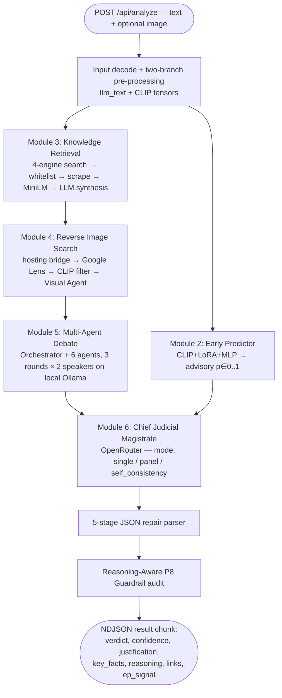

# RAHMAD System: Comprehensive Architecture, Capabilities, and Operations Guide
**Retrieval-Augmented Hybrid Multi-Agent Debate** *(also expanded in code/report artefacts as "Reliable Automated Hybrid Multi-Agent Detection")*
*A Defense-in-Depth, Multimodal Framework for Automated Fake News and Cheapfake Verification*

> **How to use this document.** Sections 1–2 give the big picture (read these first). Sections 3–8 are a per-module deep dive written directly from the source code, with file paths, thresholds, prompts, and fallback behaviour called out explicitly. Sections 9–14 cover cross-cutting concerns: multilingual behaviour, fault tolerance, configuration, observability, and the test harness. Section 15 records maintenance notes and known quirks. Every claim in this document was verified against the code as of **2026-11-16**.

---

## Table of Contents
1. [Executive Summary & The Core Challenge](#1-executive-summary--the-core-challenge)
2. [Repository Map & High-Level Architecture](#2-repository-map--high-level-architecture)
3. [Module 1: Input Processing & Validation](#3-module-1-input-processing--validation)
4. [Module 2: Early Predictor (EP) — Rapid Multimodal Assessment](#4-module-2-early-predictor-ep--rapid-multimodal-assessment)
5. [Module 3: Knowledge Retrieval (KR) — External Fact Grounding](#5-module-3-knowledge-retrieval-kr--external-fact-grounding)
6. [Module 4: Reverse Image Search (RIS) — Visual Provenance & Cheapfake Detector](#6-module-4-reverse-image-search-ris--visual-provenance--cheapfake-detector)
7. [Module 5: Multi-Agent Debate (MAD) — Adversarial Dialectic](#7-module-5-multi-agent-debate-mad--adversarial-dialectic)
8. [Module 6: Chief Judicial Magistrate (The Judge)](#8-module-6-chief-judicial-magistrate-the-judge)
9. [Multilingual Capabilities & Cross-Lingual Fallback Architecture](#9-multilingual-capabilities--cross-lingual-fallback-architecture)
10. [End-to-End Fault Tolerance & Fallback Matrix](#10-end-to-end-fault-tolerance--fallback-matrix)
11. [Configuration & Environment Variables](#11-configuration--environment-variables)
12. [Observability: Forensic Logging](#12-observability-forensic-logging)
13. [Testing & Evaluation Harness](#13-testing--evaluation-harness)
14. [Empirical Validation & Ablation Benchmarks](#14-empirical-validation--ablation-benchmarks)
15. [Maintenance Notes & Known Quirks](#15-maintenance-notes--known-quirks)
16. [Comprehensive Glossary of Terms](#16-comprehensive-glossary-of-terms)

---

## 1. Executive Summary & The Core Challenge

### 1.1 What is RAHMAD?
**RAHMAD** stands for **Retrieval-Augmented Hybrid Multi-Agent Debate** (rendered in some reports as *Reliable Automated Hybrid Multi-Agent Detection*). It is a multimodal AI framework that detects, classifies, and explains online misinformation. Unlike traditional "black-box" fake-news detectors that output only a vague probability (e.g., *"78% Fake"*), RAHMAD operates like a **high-tech courtroom**: it screens incoming content in milliseconds, dispatches autonomous investigators to retrieve live web evidence, traces the origin of any attached photograph, runs an adversarial trial between automated debaters, and delivers a transparent judicial ruling citing verifiable primary sources.

### 1.2 The Modern Misinformation Challenge: Why Traditional AI Fails
Early fake-news detectors relied on linguistic patterns (clickbait words, excessive exclamation marks, conspiracy keywords). Modern deception has evolved into sophisticated multimodal formats:

1. **Multimodal Cheapfakes (Decontextualization):** Rather than Photoshop or generative deepfakes, bad actors frequently take a **100% authentic, unmanipulated photograph** from a past disaster or foreign country and attach it to an unrelated breaking story (e.g., pairing a 2018 Indonesian flood photo with a breaking Malaysian flood claim). Text-only models fail because the photo is real; vision models fail because the text reads like legitimate news.
2. **Text-Image Mismatch Blindspots:** If an article contains genuine AP/Reuters wire prose paired with an unrelated photograph, a pure text checker finds no factual error in the prose and misses that the image depicts something else entirely.
3. **Black-Box Hallucinations:** An LLM evaluated on its own can hallucinate facts or fall victim to the visual halo effect (assuming an article is true simply because it carries a professional-looking photo).

### 1.3 The RAHMAD Philosophy: Defense-in-Depth & Hybrid Multimodal Verification
RAHMAD unites three AI paradigms:

* **Rapid Multimodal Baseline Assessment:** a local, lightweight CLIP+LoRA model evaluates the article in ~150 ms to establish an initial multimodal prior. **It never gates or filters any case** — every article proceeds to the full pipeline.
* **Autonomous External Forensic Verification:** retrieval agents verify real-world facts via multi-engine news search against a whitelisted source list, and trace visual media origins via Google Lens.
* **Adversarial Dialectic & Judicial Synthesis:** multiple AI agents debate in structured roles to expose selective quoting and rhetorical manipulation, followed by a Supreme-Court-style deliberation layer that applies explicit constitutional principles before issuing a verdict.

```
┌─────────────────────────────────────────────────────────────────────────────────┐
│                           THE COURTROOM ANALOGY                                │
├─────────────────────────┬───────────────────────────────────────────────────────┤
│ System Component        │ Courtroom Equivalent                                  │
├─────────────────────────┼───────────────────────────────────────────────────────┤
│ Input Processing        │ The Bailiff: validates documents, cleans raw evidence │
│ Early Predictor (EP)    │ First Responder: instant sub-second initial read      │
│ Knowledge Retrieval (KR)│ Lead Investigator: pulls files from news archives     │
│ Reverse Image Search    │ Forensic Lab: traces where the photo was first taken  │
│ Multi-Agent Debate (MAD)│ Prosecution & Defense: argue biases & discrepancies   │
│ Chief Judicial Judge    │ Supreme Court Magistrate: weighs evidence and rules   │
└─────────────────────────┴───────────────────────────────────────────────────────┘
```

---

## 2. Repository Map & High-Level Architecture

### 2.1 Repository Map

```
RAHMAD/
├── app.py                      # Flask entry point. Serves frontend, exposes POST /api/analyze (NDJSON stream)
├── requirements.txt            # Dependencies (Flask, torch, transformers, peft, scrapy, trafilatura, ...)
├── .env / .env.example         # Secrets & runtime configuration (see Section 11)
│
├── frontend/                   # Single-page dashboard (served by Flask static folder)
│   ├── index.html              # Input panel, live process stream, verdict card, evidence links
│   ├── styles.css              # Dashboard styling incl. verdict color classes
│   └── script.js               # NDJSON stream reader (Fetch API), status rendering, result rendering
│
├── backend/                    # Web-facing orchestration & utilities
│   ├── analyzer.py             # ★ THE pipeline orchestrator. analyze_text() generator → NDJSON chunks
│   ├── input_processing.py     # Two-branch pre-processing: clean LLM text + CLIP tensors
│   ├── input_retrieval.py      # Loads default test article from res/ (module self-tests only)
│   ├── domain_whitelist.py     # VERIFIED_DOMAINS set (76 accredited outlets) + is_domain_whitelisted()
│   ├── news_spider.py          # Scrapy spider (runspider subprocess) extracting title/text/date via trafilatura
│   ├── pipeline_logger.py      # PipelineLogger → output/output_log.txt (structured per-stage audit log)
│   └── analyzer_new.py         # ⚠ STALE near-duplicate of analyzer.py — imported nowhere (see §15)
│
├── model/                      # The six AI modules
│   ├── early_predictor.py      # CLIP ViT-B/32 + LoRA + MLP head inference wrapper
│   ├── knowledge_retrieval.py  # 4-engine news search → whitelist filter → scrape → semantic filter → LLM synthesis
│   ├── reverse_image_search.py # Image hosting bridge → SerpApi Google Lens → CLIP visual filter → Visual Agent LLM
│   ├── mad_orchestrator.py     # Debate orchestrator: context summary, profile assignment, consolidation, logging
│   ├── mad_agent.py            # DebaterAgent: role/side/speaker-structured argument generation
│   ├── shared_memory.py        # SharedMemoryBank: immutable per-stage argument history
│   ├── llm_client.py           # LLMClient: local Ollama client with model fallback chain (used by MAD)
│   └── judge.py                # Judge: OpenRouter reasoning layer, constitution, P8 guardrail, 3 modes
│
├── data_processing/
│   └── early_predictor_output/ # ★ Trained EP artifacts (runtime-required):
│       ├── lora_adapter/       #     PEFT LoRA adapter (r=16, α=32, dropout 0.1)
│       ├── mlp_head.pt         #     Linear(1024→1)+Sigmoid head state dict
│       └── processor/          #     CLIPProcessor (tokenizer + image processor)
│
├── archive/                    # Historical material: training scripts (train_early_predictor.py),
│   │                           #   dataset prep, fyp.ipynb, architecture notes. Not imported at runtime
│   └── data_processing/        #   (fallback location for EP artifacts if data_processing/ copy is absent)
│
├── testing/                    # 3-phase test suite + evaluation harness (see Section 13)
│   ├── test_phase1_unit.py / test_phase2_integration.py / test_phase3_evaluation.py
│   ├── run_phase3_*.py / run_combined_120_pipeline.py / rerun_*.py   # Evaluation runners
│   ├── test_dataset_fauxtography.csv / test_dataset_newsclippings.csv / test_dataset_combined.csv
│   ├── .cache_kr_*.json / .cache_ris_*.json / .cache_mad_*.json      # Pre-computed module output caches
│   ├── .checkpoint_*.json                                            # Resumable evaluation checkpoints
│   └── *_evaluation_results.json / .txt                              # Benchmark result artefacts
│
├── output/                     # Runtime forensic logs (auto-generated, overwritten each run)
│   ├── output_log.txt          # Full unified pipeline log (PipelineLogger)
│   ├── JUDGE_output.txt / KR_output.txt / RIS_output.txt / MAD_output.txt
│
├── res/                        # Bundled test articles (news1–news3 .txt/.jpg/.webp, newsAI1.png)
│                               #   Served over HTTP at /res/<filename>
├── docs/                       # This documentation
└── scratch/, venv/, .claude/, .opencode/, .pytest_cache/
```

### 2.2 Web Tier & API Surface (`app.py`)
* **Flask** app with `static_folder='frontend'`, CORS enabled, run on `http://127.0.0.1:5000` with `debug=True`.
* **Endpoints:**
  | Route | Method | Purpose |
  |---|---|---|
  | `/` | GET | Serves `frontend/index.html` (the dashboard) |
  | `/res/<path:filename>` | GET | Serves bundled sample articles/images |
  | `/api/analyze` | POST | Body `{ "text": "...", "image": "<base64 data-URL or http(s) URL or null>" }`. Returns an **NDJSON stream** (`application/x-ndjson`) |
* `dotenv` is loaded **before** `backend.analyzer` is imported so the Judge picks up `OPENROUTER_API_KEY`.
* The handler wraps the `analyze_text()` generator and serializes each yielded dict to one JSON line.

### 2.3 Complete Pipeline Flow (`backend/analyzer.py`)

`analyze_text(input_text, image_data)` is a **generator** that executes the pipeline **sequentially** (not concurrently) and yields status/result chunks. Heavy models are lazy-loaded as module-level singletons (`_get_predictor()`, `_get_retriever()`, `_get_ris_pipeline()`, `_get_mad_orchestrator()`, `_get_judge()`) so Flask starts fast and each model is loaded at most once.



**Stage order & status events.** Each stage emits a `status` event with `IN PROGRESS` and then a terminal `OK` / `FAIL`. The seven canonical steps (mirrored 1:1 by the frontend) are:

1. `PRE-PROCESSING INPUT...`
2. `RUNNING EARLY PREDICTOR...`
3. `FETCHING EVIDENCE...` (KR)
4. `SEARCHING FOR SIMILAR IMAGES...` (RIS)
5. `DEBATING...` (MAD)
6. `SYNTHESIZING RESULTS...` (Judge)
7. `OUTPUTTING PREDICTION...`

followed by a final `{"type": "result", "data": {...}}` chunk.

**KR query construction:** the retriever is called with `input_text[:800]` — the first line (headline) drives the search query while the rest provides claim context for semantic verification.

**Evidence wiring into the Judge:** KR summary → `external_knowledge`; RIS verdict (category, out-of-context flag, confidence, `judge_summary`) → `ris_summary`; MAD consolidation → `mad_summary`; EP output → `ep_signal`. The Judge always makes the final call.

**Frontend links:** the top **6** KR articles (whitelisted headlines + URLs, including unextractable "supporting link" entries) are formatted into `result["links"]` as `{source, title, url}` for the dashboard's *Supporting Links* section.

### 2.4 NDJSON Streaming Contract
```json
{"type": "status", "step": "PRE-PROCESSING INPUT...", "status": "IN PROGRESS"}
{"type": "status", "step": "PRE-PROCESSING INPUT...", "status": "OK"}
{"type": "status", "step": "RUNNING EARLY PREDICTOR...", "status": "FAIL"}
...
{"type": "result", "data": { ...final judicial payload... }}
```
The frontend (`frontend/script.js`) POSTs to the hardcoded endpoint `http://127.0.0.1:5000/api/analyze` and consumes the stream via `response.body.getReader()`, splitting on newlines and matching each `step` string to a pre-drawn log line (statuses rendered: `OK`, `IN PROGRESS`, `FAIL`; `SKIPPED` is styled as `OK`). The final `data` payload contract:

| Field | Type | Notes |
|---|---|---|
| `verdict` | str | One of 8 classes (see §8.2) |
| `color_class` | str | `satire`, `false-connection`, `misleading`, `imposter`, `manipulated`, `fabricated`, `credible`, `inconclusive` |
| `confidence` | str | e.g. `"87.0%"` — frontend colors `<50` low, `<70` mid, else high |
| `justification` | str | 3–6 sentence user-facing explanation (markdown bold allowed) |
| `key_facts` | list | 3–5 user-facing observations |
| `reasoning` | str | CoT scratchpad (rendered in a collapsible "detailed reasoning" accordion) |
| `links` | list | Top-6 KR articles `{source, title, url}` |
| `ep_signal` | dict | EP result passed through for frontend transparency |

---

## 3. Module 1: Input Processing & Validation
* **Source Location:** `backend/input_processing.py`, image decoding in `backend/analyzer.py:_decode_image()`
* **Execution Environment:** Local Python (CPU)
* **Average Latency:** `< 100 ms`

### 3.1 Purpose
Before raw text and images are fed into neural networks they must be sanitized and normalized. The Input Processor produces **two parallel pre-processing branches**, exactly as in the original training notebook (`archive/fyp.ipynb`):

1. **LLM Branch — `clean_for_llm(raw_text)`:** normalizes Unicode/encoding artefacts, transliterates to ASCII, and strips URLs / email addresses / phone numbers by replacing them with readable `<URL>`, `<EMAIL>`, `<PHONE>` placeholders. It **preserves casing, punctuation, numbers, currency symbols, and line breaks** so reasoning LLMs keep full semantic context. (Uses the `clean-text` package.)
2. **CLIP Branch — `preprocess_inputs()`'s vision path:**
   * `extract_and_clean_lead_text()` takes the **headline + first body sentence** (first two non-empty lines), lowercases and collapses it to a single line.
   * `tokenize_text()` → CLIP tokenizer, `padding="max_length"`, `truncation=True`, **77-token window** (CLIP's hard limit) → `input_ids [1,77]`, `attention_mask [1,77]`.
   * `process_image()` → CLIPImageProcessor: resize 224×224, centre-crop, normalize → `pixel_values [1,3,224,224]`.

> [!NOTE]
> An earlier revision of this document described a "512-token clip_text". The actual CLIP window is **77 tokens over the lead text only** (headline + first sentence). Full-body text goes to the Judge via the LLM branch (truncated to 6,000 chars in `model/judge.py`).

### 3.2 Image Decoding
`_decode_image()` accepts:
* **Base64 data URIs** (`data:image/jpeg;base64,...`) — decoded via `base64` → `PIL.Image.RGB`.
* **Plain HTTP/HTTPS URLs** — fetched with `urllib.request` → PIL RGB.
* Anything else, or any decode failure → `None` (graceful skip, no exception).

### 3.3 Guardrails & Fallback Behaviors
* **Missing Image Fallback:** no image ⇒ `preprocess_inputs` is not called; `clean_for_llm()` runs alone; EP and RIS are cleanly skipped (see the neutral EP signal in §4.4); text-only verification proceeds unimpeded.
* **Pre-processing Failure Fallback:** if `preprocess_inputs()` throws, the analyzer logs the failure and falls back to text-only mode rather than aborting.

---

## 4. Module 2: Early Predictor (EP) — Rapid Multimodal Assessment
* **Source Location:** `model/early_predictor.py` (artifacts in `data_processing/early_predictor_output/`; training script in `archive/data_processing/train_early_predictor.py`)
* **Execution Environment:** PyTorch — device auto-resolution: **DirectML (AMD GPU) → CUDA → CPU**
* **Average Latency:** **~118–182 ms** per sample (measured in Phase-3 evaluations)

### 4.1 Purpose & Advisory Role
The EP gives an immediate, sub-second multimodal read of text–image alignment, producing a preliminary suspicion score.

> [!IMPORTANT]
> **EP is NOT a filter or gate.** `pass_to_agents` is hardcoded `True` in `_build_verdict()`. Every article — regardless of EP label or confidence — unconditionally proceeds to KR, RIS, and MAD. The EP probability is strictly an advisory prior handed to the Judge (which is instructed, via Principle P6, to treat it as evidence, not authority).

### 4.2 Architecture & Artifacts
```
[Lead Text (headline+first sentence)] ──► [CLIP Text Transformer]  ──► text_embeds [512] ┐
                                                                                        ├─► concat [1024]
[Article Image 224×224]              ──► [CLIP ViT-B/32 Vision]    ──► image_embeds [512] ┘
                                                                                        │
                                                                        [Linear(1024 → 1) + Sigmoid]
                                                                                        │
                                                                        Fake probability p ∈ [0, 1]
```
* **Base model:** `openai/clip-vit-base-patch32`, frozen.
* **LoRA adapters (PEFT, `adapter_config.json`):** `r=16`, `lora_alpha=32`, `lora_dropout=0.1`, `bias="none"` — applied to **q_proj and v_proj of both the vision and text encoder attention layers**, plus `text_projection` and `visual_projection`.
* **Head:** single-layer `_MLPHead`: `Linear(1024 → 1)` + `Sigmoid` (state dict in `mlp_head.pt`, remapped from `0.*` → `net.0.*` keys at load time).
* **Text cleaning consistency:** `_clean_text_for_clip()` replicates the training-time regex cleaner exactly (HTML strip, URL strip, emoji strip, punctuation filter, lowercase) so inference inputs match the training distribution.
* **Artifact resolution:** prefers `data_processing/early_predictor_output/`; falls back to `archive/data_processing/early_predictor_output/` if the primary copy is missing. Missing artifacts raise a clear `FileNotFoundError` telling the operator to run the trainer.

### 4.3 Decision Thresholds (runtime)
```
p ≥ 0.60  →  label FAKE       (color_class "manipulated")
p ≤ 0.40  →  label REAL       (color_class "real")
0.40 < p < 0.60 → label UNCERTAIN (color_class "inconclusive")
```
`pass_to_agents` is `True` in all three branches. (Note: the offline evaluation harness scores EP with a plain 0.50 binary boundary — that is a benchmarking convention, not the runtime behaviour.)

### 4.4 Fallback Behaviour (no image)
When no image is supplied, the analyzer substitutes a neutral signal **without loading the model**:
```json
{
  "probability": 0.5,
  "label": "UNKNOWN",
  "confidence": "N/A",
  "pass_to_agents": true,
  "note": "EP failed — no image provided; Judge will rely on text only."
}
```
An EP runtime exception produces the same skip path (logged as `log_ep_skipped` in the pipeline log), and the frontend `RUNNING EARLY PREDICTOR...` step shows `FAIL` while the pipeline continues.

### 4.5 Capabilities vs. Inherent Limitations
* **Capabilities:** ~150 ms inference; catches obvious memes, digitally distorted text-image mismatches, viral clickbait graphics.
* **Limitations:** CLIP embeddings carry no external factual knowledge — a genuine 2017 flood photo paired with a fake 2026 text claim scores as plausible ("water"–"flood" affinity). This is precisely why EP is advisory and why KR/RIS/MAD exist.

### 4.6 Public API
`predict(raw_text, raw_image)` for standalone use; `predict_from_tensors(...)`, and `predict_from_tensors_verbose(...)` (also returns `text_embeds`, `image_embeds`, `fused` for logging) — the latter is what the pipeline uses. Each module includes a self-test entry point (`python -m model.early_predictor`) that loads the bundled sample from `res/` via `backend/input_retrieval`.

---

## 5. Module 3: Knowledge Retrieval (KR) — External Fact Grounding
* **Source Location:** `model/knowledge_retrieval.py`, `backend/domain_whitelist.py`, `backend/news_spider.py`
* **Execution Environment:** Hybrid — multi-engine web search + Scrapy/trafilatura scraping + OpenRouter LLM (or local Ollama if `USE_LOCAL_LLM=true`)
* **Average Latency:** `~3 – 15 s` (search cascade + 25 s-capped spider subprocess)

### 5.1 Purpose
An LLM cannot verify whether an event occurred by staring at the text. KR acts as an automated investigative journalist: query live search engines, keep only accredited outlets, extract and verify the articles actually discuss the claim, and condense findings into a factual evidence dossier.

### 5.2 Execution Pipeline (`KnowledgeRetriever.retrieve_detailed(claim)`)
```
[Claim = input_text[:800]]
        │
        ▼
1. QUERY CONSTRUCTION
   • First non-empty line = search query (headline preserved)
   • Strips wire datelines ("KUALA LUMPUR, Sept 9 (Reuters) -")
   • Truncates to first complete sentence, max 140 chars
        │
        ▼
2. FOUR-TIER SEARCH CASCADE (stops augmenting when enough URLs found)
   ① DuckDuckGo HTML endpoint (html.duckduckgo.com/html/, parsed w/ BeautifulSoup)
   ② DDGS package news search (if < 5 URLs so far)
   ③ Google News RSS (news.google.com/rss/search) + googlenewsdecoder URL resolution
   ④ SerpAPI Google News (tbm=nws, social-site site: exclusions) — if < 3 URLs so far
   • Every tier filters social/user-generated URLs via SOCIAL_MEDIA_DOMAINS blocklist
     (facebook, x/twitter, instagram, tiktok, reddit, youtube, linkedin, pinterest, weibo, threads)
        │
        ▼
3. STRICT DOMAIN WHITELIST (backend/domain_whitelist.py — 76 domains, exact + subdomain match)
        │
        ▼
4. CONTENT EXTRACTION (two layers)
   ① Scrapy spider subprocess (backend/news_spider.py, temp dir, --nolog, 25 s timeout,
      ROBOTSTXT_OBEY=False, 8 concurrent requests, trafilatura → BeautifulSoup fallback,
      drops pages with < 100 chars of text)
   ② Direct requests + trafilatura / og:title / <p> fallback for any URL the spider missed
   • Dedupe by title; naive year check drops articles older than max_age_years = 3
   • Keep at most max_articles = 5
   • Unextractable whitelisted URLs (paywalls, anti-bot 401s) are NOT discarded — they are
     preserved as "[Supporting Link]" entries with titles from search metadata or a
     URL-slug headline deriver (extract_title_from_url_slug)
        │
        ▼
5. SEMANTIC VERIFICATION (all-MiniLM-L6-v2)
   • Article text chunked by paragraph (chunks > 50 chars)
   • Cosine similarity vs claim; threshold ≥ 0.35; keep top 3 chunks per article
   • If embedder failed to load → bypass with first 300 words per article
        │
        ▼
6. LLM SYNTHESIS (strict "research analyst" prompt — no inference/hallucination,
   entities, amounts, rulings, timelines only from snippets)
   • Cloud default: nvidia/nemotron-3-nano-omni-30b-a3b-reasoning:free via OpenRouter
     (temperature 0.2, max_tokens 1200, timeout 120 s)
   • Local option: any OpenAI-compatible endpoint when USE_LOCAL_LLM=true
   • Multi-model fallback chain from LOCAL_LLM_MODEL_FALLBACK / OPENROUTER_MODEL_FALLBACK
   • If all models fail → raw snippets joined as summary (never empty)
        │
        ▼
[Structured dossier: {claim, articles[], summary, llm_used} → Judge & Debate]
```

### 5.3 The Accredited Domain Whitelist (`backend/domain_whitelist.py`)
`VERIFIED_DOMAINS` contains **76 domains** across 9 categories, enforced by `is_domain_whitelisted()` (strips `www.`, matches exact or subdomain):
* **News Agencies (5):** Reuters, AP, AFP, Bloomberg, news.google.com.
* **US Outlets (9):** NYT, Washington Post, WSJ, NPR, PBS, CNN, NBC, CBS, ABC News.
* **UK Outlets (7):** BBC, Guardian, FT, The Times, Independent, Telegraph.
* **International/Regional (18):** Al Jazeera, SCMP, CNA, Straits Times, The Hindu, RFI, DW, France24, Euronews, Jakarta Post, Kompas, Tempo, Antara, Dawn, GMA, and Australian outlets.
* **Malaysian Outlets (8):** Bernama, Astro Awani, Malaysiakini, The Star, New Straits Times, Malay Mail, Free Malaysia Today, The Edge Markets.
* **Science/Tech/Health (13):** NASA, Nature, Scientific American, New Scientist, TechCrunch, Wired, Ars Technica, The Verge, CDC, WHO, NIH, Space.com, ScienceMag.
* **Additional majors (7):** Time, Forbes, Business Insider, Politico, USA Today, LA Times, MSN.
* **Fact-checkers (4):** Snopes, PolitiFact, FactCheck.org, Full Fact.
* **Extended (5):** US News, Yahoo, Bangkok Post, The Edge Malaysia, AsiaOne.

### 5.4 Fallback & Resilience Mechanics
* **No URLs / no whitelisted URLs / no metadata / no semantic snippets:** every stage returns a *structured, explicit* failure summary string (e.g., `"No URLs passed the domain whitelist filter."`) rather than an exception — the Judge always receives an honest statement of what was (not) found.
* **Anti-scraping / paywall resilience:** unextractable articles become "supporting links" with derived headlines and a summary noting extraction was blocked by publisher protections; KR keeps and surfaces their URLs to the frontend.
* **Embedder outage:** semantic filter degrades to raw-text truncation.
* **Full KR exception:** caught by the analyzer, which forwards `"Knowledge Retrieval encountered an error: ..."` so the pipeline never aborts.
* **Audit trail:** every stage is logged to `output/KR_output.txt` (URLs with pre-filter status tags, extracted articles, snippets with threshold, summary, final status).

---

## 6. Module 4: Reverse Image Search (RIS) — Visual Provenance & Cheapfake Detector
* **Source Location:** `model/reverse_image_search.py`
* **Execution Environment:** Hybrid — SerpApi (Google Lens) + CLIP ViT-B/32 + MiniLM + OpenRouter / local LLM "Visual Agent"
* **Average Latency:** `~3 – 6 s`

### 6.1 Purpose
Cheapfakes (a genuine image re-captioned with a false narrative) dominate real-world visual misinformation. RIS is a digital photo-forensics lab: it finds where the photo already appeared online, filters candidates by visual identity, and diagnoses whether the current headline is an authentic use or a deceptive out-of-context recycling.

### 6.2 The 4-Stage Forensic Architecture
```
[Target Image (data-URL | local file | http URL)]
        │
        ▼
1. PUBLIC-HOSTING BRIDGE + SERPAPI GOOGLE LENS
   • 5-tier upload fallback: ImgBB (if IMGBB_API_KEY) → freeimage.host →
     tmpfiles.org → envs.sh → catbox.moe
   • Google Lens engine via SerpApi → top-10 visual_matches
   (title, link, thumbnail, source per match)
        │
        ▼
2. VISUAL SIMILARITY FILTER — CLIP ViT-B/32 image-to-image
   • cosine(target_embed, thumbnail_embed) ≥ 0.68
   • Language-agnostic by construction (raw pixels only)
        │
        ▼
3. SEMANTIC CONTEXT FILTER — all-MiniLM-L6-v2
   • cosine(claim, candidate_title) ≥ 0.0  ← default threshold is permissive
     (records similarity scores for the audit log; only empty titles fail)
   • AUTOMATIC FALLBACK: candidate_contexts =
       semantically_filtered if semantically_filtered else visually_filtered
     → visual evidence is never lost to a context/text mismatch
        │
        ▼
4. LLM VISUAL FORENSIC AGENT (temperature 0.1, response_format json_object,
   multi-model fallback chain)
   • Inputs: headline + first 800 chars of body + Lens match titles/sources
   • 6 journalistic rules incl. ANTI-HALLUCINATION ARCHIVAL RULE (archival photo of a
     historical event the text actually claims = AUTHENTIC, never "recycled"),
     SYNDICATION RULE (multiple outlets reusing a wire photo ≠ deceptive recycling),
     and TOPICAL MISMATCH RULE (a completely foreign entity/subject image = CHEAPFAKE)
   • Emits: category, is_out_of_context, confidence (High/Medium/Low),
     summary, judge_summary (explicitly framed for the Judge)
```

### 6.3 Standardized Forensic Taxonomy (exactly one category)
1. **`Authentic Context / Matching Event`** (`is_out_of_context: false`) — the image depicts the actual event, location, or subject described.
2. **`Out-of-Context (Misattributed / Recycled)`** (`is_out_of_context: true`) — demonstrably recycled from a different year, event, or country. **The definition of a Cheapfake.**
3. **`Generic / Illustrative Imagery`** (`is_out_of_context: false`) — relevant stock/file/portrait imagery used non-deceptively.
4. **`Inconclusive / Insufficient Evidence`** (`is_out_of_context: false`) — ambiguous provenance.

The pipeline normalizes free-text LLM category strings back onto these four canonical labels (keyword matching on "out-of-context"/"recycled"/"authentic"/"generic", with a prose-response fallback if JSON parsing fails).

### 6.4 Fallback Mechanics & Audit Trail
* **Hosting bridge:** 5-tier host fallback as above; total failure returns `[]` with a logged error (status `failed`).
* **No image:** `log_skipped()` writes a structured `SKIPPED` entry to `output/RIS_output.txt`; the analyzer forwards `"Reverse Image Search failed: No image provided."` to the Judge.
* **SerpApi quota/error:** caught → `Inconclusive / Insufficient Evidence` style summary; pipeline continues.
* **Missing API key:** the Visual Agent returns a structured low-confidence inconclusive result instead of crashing.
* **Audit trail:** `output/RIS_output.txt` records the public search URL, every raw Lens match, per-candidate CLIP similarity scores with PASS/FAIL tags, MiniLM scores, the full Visual Agent context + synthesis, and the evidentiary summary forwarded to the Judge.

---

## 7. Module 5: Multi-Agent Debate (MAD) — Adversarial Dialectic
* **Source Location:** `model/mad_orchestrator.py`, `model/mad_agent.py`, `model/shared_memory.py`, `model/llm_client.py`
* **Execution Environment:** **Local Ollama** via `LLMClient` (`LOCAL_LLM_MODEL`, fallback chain from `LOCAL_LLM_MODEL_FALLBACK`, `OLLAMA_BASE_URL`, 180 s timeout per call)
* **Average Latency:** `~10 – 40 s` on local hardware (9 LLM calls total: 1 context summary + 1 profile assignment + 6 debate arguments — 3 rounds × 2 speakers, each agent speaks once — + 1 consolidation… see below)

### 7.1 Purpose
A single LLM inspecting an article is vulnerable to confirmation bias. MAD eliminates this through **adversarial debate**: three agents argue the article is authentic ("Real News") while three argue it is fabricated ("Fake News"), forcing weaknesses, selective quoting, and hidden assumptions into the open.

### 7.2 Debate Protocol & Workflow
```
[Cleaned Article Text + Verified KR Context]
                    │
                    ▼
   1. Orchestrator.summarize_context()
      • LLM extracts core factual claims + political/social framing analysis
      • Appends the KR evidence block verbatim ("Direct from Knowledge Retrieval")
                    │
                    ▼
   2. Orchestrator.assign_profiles()
      • LLM generates 6 domain-specific role titles as a strict JSON list
      • Fallback personas on parse/timeout failure:
        Investigative Journalist, Forensic Data Analyst, Political Fact-Checker,
        Media Context Analyst, Public Records Specialist, Source Verification Expert
                    │
                    ▼
   3. Six DebaterAgents — 3 per side, fixed speaker ladder:
        Real News:  Agent_1 (First Speaker)  Agent_2 (Second)  Agent_3 (Third)
        Fake News:  Agent_4 (First Speaker)  Agent_5 (Second)  Agent_6 (Third)
      Three stages, two turns each (Real then Fake):
        Stage 1 "Round 1: First Speakers"   → agents[0], agents[1]
        Stage 2 "Round 2: Second Speakers"  → agents[2], agents[3]
        Stage 3 "Round 3: Third Speakers"   → agents[4], agents[5]
                    │
                    ▼
   4. Orchestrator.consolidate_discourse()
      • Neutral scholarly synthesis: Real-side arguments, Fake-side arguments,
        clash points, and evidential weight → single dossier for the Judge
```

### 7.3 Speaker-Role Discipline (`model/mad_agent.py`)
Each speaker role has a mandatory structure:
* **First Speaker:** stance intro → substantive arguments from own expertise → 1–2 sentence case summary → conclusion. (The Real-side First Speaker is the only agent excused from the rebuttal instruction.)
* **Second Speaker:** acknowledges flow → **vigorous rebuttal with the "even if" tactic** → ≤ 2-sentence summary of the first speaker → **brand-new domain-specific arguments** (anti-regurgitation) → team synthesis → conclusion.
* **Third Speaker:** frames the final clash → systematic rebuttal → crystallized team-case weighing → *no new constructive arguments* → authoritative closing. This role is explicitly exempted from the global anti-regurgitation and domain-specialization rules via a **CRITICAL OVERRIDE** clause in its system prompt: its job is to weigh the evidence already on the record, expose the opposing team's weakest links, identify the decisive clash point, and deliver the final verdict — every substantive point must be anchored to material already in the debate history.

Global rules baked into every system prompt: (1) strict anti-regurgitation, (2) concise summaries, (3) full embodiment of the assigned profile, (4) **debate factual veracity only** — never policy merit/economic viability, (5) evaluate political climate and bias, and the Fake-side *critical cheapfake check* ("an authentic photo alone does NOT prove an uncorroborated story"). Rules (1) and (3) are the reason the Second Speakers aggressively differentiate themselves — and, before the CRITICAL OVERRIDE was added, they also overrode the Third Speakers' no-new-arguments instruction, causing third-speaker turns to resemble second-speaker turns (three fresh "new evidence" blocks instead of clash weighing). The OVERRIDE resolves this conflict in favour of the weighing role.

### 7.4 The Shared Memory Bank (`model/shared_memory.py`)
All arguments are appended to a `SharedMemoryBank` keyed by the three stages. Every agent receives the **full formatted history** (article + orchestrator context + all prior arguments with speaker labels) before generating its own turn, forcing direct engagement with opposing arguments rather than parallel monologues.

### 7.5 Fallbacks & Audit Trail
* **Profile-generation failure:** regex JSON parse failure or LLM error ⇒ the six hardcoded fallback personas are injected instantly.
* **Ollama unreachable / model error:** `LLMClient` walks its fallback model chain (each `requests.post` timeout 180 s); if all fail it returns the last error string, which becomes part of the debate record; a top-level exception in `run_debate()` is caught by the analyzer and forwarded as `"Multi-Agent Debate encountered an error: ..."` so the Judge still deliberates.
* **Audit trail:** `output/MAD_output.txt` logs the original article, the context summary, both teams' profiles, every argument by stage with `[Side] [Round] Speaker:` headers, and the consolidated synthesis.

---

## 8. Module 6: Chief Judicial Magistrate (The Judge)
* **Source Location:** `model/judge.py`
* **Execution Environment:** **OpenRouter cloud LLM only.** Primary `deepseek/deepseek-v4.1-flash`; fallback chain `z-ai/glm-5.3-flash` → `stealth/space-bunny-alpha` → `deepseek/deepseek-v4-flash-0731` (configurable via `JUDGE_MODEL` / `JUDGE_MODEL_FALLBACK`; at runtime the chain is built as `[primary] + fallback list` with duplicates of the primary dropped, so the configured primary-first fallback entry is a no-op and 4 distinct models are tried in total).
* **Call parameters:** temperature `0.2` (single/panel), `max_tokens 4096`, HTTP timeout `45 s`, `reasoning: {"effort": "low"}`
* **Average Latency:** `~2 – 5 s` (single) / `~15 – 30 s` (panel or self-consistency, parallelised)

### 8.1 Purpose
The Judge is RAHMAD's supreme decision authority. It does not search or debate; it ingests **all four evidence streams** (EP prior, KR dossier, RIS visual provenance, MAD clash points) through a user-message template with explicit per-stream sections, applies a written constitution, and renders a binding structured verdict. Article text is truncated to **6,000 characters** (`_MAX_TEXT_CHARS`).

### 8.2 Output Taxonomy (8 classes)
`SATIRE OR PARODY` · `FALSE CONNECTION` · `MISLEADING CONTENT` · `IMPOSTER CONTENT` · `MANIPULATED CONTENT` · `FABRICATED CONTENT` · `CREDIBLE` · `INCONCLUSIVE` — each mapped to a `color_class` for the frontend. Fuzzy verdict normalization maps model synonyms ("LEGITIMATE", "REAL NEWS", "FABRICATION", "IMPOSTOR", …) onto canonical labels; unrecognised output defaults to `INCONCLUSIVE`.

### 8.3 The Constitution (Principles P1–P9)
1. **P1 Evidence over intuition** — ground every claim in observable signals.
2. **P2 Absence of evidence ≠ evidence of falsehood.**
3. **P3 Distinguish writing style from intent** (satire vs misleading).
4. **P4 Context determines meaning** — accurate facts can still be MISLEADING.
5. **P5 Calibrated confidence** — >85% confidence requires ≥3 independent signals.
6. **P6 Treat the Early Predictor as evidence, not authority.**
7. **P7 Cross-verify with Knowledge Retrieval** — KR is treated as ground-truth factual context; corroboration ⇒ CREDIBLE, contradiction ⇒ FABRICATED/MISLEADING/FALSE CONNECTION.
8. **P8 Cross-verify visual context via RIS**, with two critical caveats:
   * *Caveat 1 — Authentic photo ≠ credible text:* an authentic image only proves the media file itself is genuine; uncorroborated text claims paired with it must still be graded FALSE CONNECTION / MISLEADING.
   * *Caveat 2 — Evidentiary hierarchy:* verified KR fact-checking **outranks** automated visual heuristics; archival photos corroborated by KR must not be penalised as "recycled".
9. **P9 Incorporate Multi-Agent Debate perspectives.**

### 8.4 Reasoning Protocol (Chain-of-Thought + Step-Back + Self-Refine)
A mandatory 7-step scratchpad is captured in the `reasoning` field:
1. **Domain orientation** (Step-Back: domain norms and typical manipulation tactics)
2. **Claim extraction** (3–5 claims labelled VERIFIABLE / VAGUE / UNFALSIFIABLE)
3. **Internal consistency audit** (headline↔body, quotes↔sources, statistics)
4. **Framing & style analysis** (emotional language, urgency cues, propaganda patterns)
5. **Source & attribution analysis** (traceability, imposter signals)
6. **Multimodal & multi-agent evidence integration** (explicit Image-to-Text Entailment check + KR-corroboration-first hierarchy for OOC flags)
7. **Self-critique** (strongest counter-argument, update if warranted)

### 8.5 User-Friendly Terminology Enforcement
The system prompt **forbids** internal acronyms (MAD, RIS, KR, EP) in user-facing fields, and a Python sanitizer `_clean_user_facing_text()` regex-rewrites any that slip through (e.g., `"According to RIS"` → `"According to Reverse Image Search"`) across `justification`, `reasoning`, `key_facts`, and panel analyses.

### 8.6 The Three Operating Modes (`JUDGE_MODE` env var)
* **`single`** (default) — one pass with the full constitution at T=0.2. Deterministic and fast.
* **`panel`** — 3 concurrent specialist judges (ThreadPoolExecutor, T=0.2 each):
  * *Senior Fact-Checker* — corroboration/refutation of claims, image provenance, debate weighing → `factual_risk_score` 1–10.
  * *Senior Linguist* — sensationalism, emotional manipulation, rhetoric → `linguistic_risk_score` 1–10.
  * *Senior Logician* — internal consistency, source attribution, intent, fallacies → `logical_risk_score` 1–10.
  Their JSON reports are serialized into a Chief Judicial Magistrate synthesis prompt (separate `_CHIEF_JUDGE_PROMPT` constitution: factual priority, cheapfake caution, satire recognition, imposter detection, credibility and inconclusive standards) that resolves conflicts and issues the final verdict. Result carries `panel_details`.
* **`self_consistency`** — **N=3** parallel reasoning paths at **T=0.7**; majority vote on verdict; confidence averaged across majority runs; `key_facts` merged (unique, capped at 5); justification/reasoning taken from the highest-confidence majority run; vote breakdown exposed as `sc_votes`. Partial failure is tolerated — aggregation proceeds from successful runs.

### 8.7 The Reasoning-Aware Principle P8 Guardrail (Python-level)
`Judge._enforce_constitutional_guardrails()` audits the verdict **only when the verdict is `CREDIBLE` and the RIS summary contains the marker `Out-of-Context Imagery Detected: YES`**:
1. Did the Judge's reasoning/justification **acknowledge** the visual out-of-context finding? (keyword scan: "reverse image search", "out-of-context", "recycled", "decontextualized", …)
2. Did it cite **verified external evidence** confirming authenticity? (keyword scan: "knowledge retrieval", "corroborated", "snopes", "reuters", "verified", "well-documented", …)
3. **If both** → the deliberate judicial reasoning is trusted (KR outranks visual heuristics per P8 Caveat 2).
4. **If not** → the verdict is **overridden to `FALSE CONNECTION`**, a guardrail note is appended to `justification`, and a key fact is added.

> [!HISTORY]
> The original (brittle) P8 unconditionally overrode every `CREDIBLE` when RIS flagged out-of-context, falsely penalizing authentic archival photos (**61.67%** Fauxtography accuracy, 22 false positives). The reasoning-aware rewrite above recovered **+25.00 points** (→ **86.67%**). See Section 14.

### 8.8 Resilient 5-Stage JSON Parsing Pipeline
LLMs wrap JSON in backticks, emit preambles, or truncate. `_parse_response()`:
1. Strip `</think>` blocks and Markdown fences, then direct `json.loads`.
2. Regex extraction of `{"verdict": ...}` candidate blocks (scanning innermost→outermost).
3. Greedy balanced-brace extraction around the last `"verdict"` token.
4. Truncation auto-repair: close unterminated string literals and balance trailing braces while back-scanning for a parseable prefix.
5. Regex field extraction from conversational prose (also catches "final answer: …" phrasing); defaults confidence 75% and uses the tail of the raw text as justification.

If all five stages fail → structured fallback verdict `INCONCLUSIVE (0.0%)` with an explanatory justification; API/HTTP failures likewise produce the safe fallback (never an unhandled exception). The parsed verdict dict also passes `ep_signal` through for frontend transparency.

---

## 9. Multilingual Capabilities & Cross-Lingual Fallback Architecture

### 9.1 Can RAHMAD Detect Non-English News (e.g., Bahasa Melayu)?
**Yes** — by design, through pixel-level language-agnostic vision, multilingual retrieval, and cross-lingual foundation models.

### 9.2 Layer-by-Layer Multilingual Behaviour
```
┌─────────────────────────────────┬────────────────────────────────────────────────────────┐
│ Module Layer                    │ Multilingual Handling (e.g., Bahasa Melayu)           │
├─────────────────────────────────┼────────────────────────────────────────────────────────┤
│ Input Preprocessing             │ Unicode normalization; LLM branch keeps original text. │
│ Early Predictor (CLIP ViT-B/32) │ Advisory only; lower confidence on non-English is      │
│                                 │ absorbed by the 0.40–0.60 UNCERTAIN band.              │
│ Knowledge Retrieval Search      │ Searches the claim verbatim on DDG / Google News RSS.  │
│ Whitelist Ingestion             │ Bernama, Astro Awani, Malaysiakini, The Star, NST,     │
│                                 │ Malay Mail, FMT, Kompas, Tempo, Antara, Jakarta Post.  │
│ RIS Visual Matching             │ 100% language-agnostic (raw CLIP image features).      │
│ RIS Semantic Filtering          │ Permissive 0.0 default + visual fallback branch        │
│                                 │ (`semantically_filtered if … else visually_filtered`). │
│ Visual Agent & Debate LLM       │ Multilingual cloud/local models read & reason in BM.   │
│ Chief Judicial Magistrate       │ Cross-lingual synthesis; verdict labels stay English.  │
└─────────────────────────────────┴────────────────────────────────────────────────────────┘
```

### 9.3 The Cross-Lingual Cheapfake Scenario
The most dangerous Southeast-Asian cheapfakes are **cross-lingual**: a Malay-language post attaches a photograph stolen from an English-language foreign disaster report.
1. RIS matches the pixels and surfaces the original English wire coverage (Reuters/AP/CNN titles).
2. The multilingual Visual Agent reads the Malay claim and English source titles, translating across both.
3. The mismatch between what the Malay text asserts and what the photo documents is exposed.
4. The Judge issues **`FALSE CONNECTION`**.

---

## 10. End-to-End Fault Tolerance & Fallback Matrix

RAHMAD is built on the principle of **Zero Fatal Failures**: no single network drop, API limit, or model crash may abort an analysis mid-pipeline. Every stage catches its own exceptions and forwards an honest, structured statement downstream.

| Failure Event | Subsystem Handling | Fallback Output to Pipeline | Final Impact on Verdict |
| :--- | :--- | :--- | :--- |
| **No image provided** | Pre-processing & analyzer skip vision branches | Neutral EP signal (`p=0.5, UNKNOWN`), RIS `SKIPPED` log | Clean text-only verification |
| **`preprocess_inputs()` throws** | Analyzer catches, logs `log_ep_skipped` | Text-only mode (`clean_for_llm` only) | EP/RIS skipped, pipeline continues |
| **EP runtime error** | Analyzer catches exception | Neutral EP signal; step shows `FAIL` | Judge relies on text + retrieved evidence |
| **DDG HTML search fails** | Next tier engages automatically | DDGS news → Google News RSS → SerpAPI cascade | KR coverage preserved |
| **All search engines fail** | KR returns structured summary string | `"No external URLs found for the claim."` | Judge told honestly; text logic + RIS remain |
| **Paywall / anti-bot (e.g., Reuters 401)** | Spider/trafilatura fallbacks; supporting-link preservation | URL-slug or search-metadata headlines kept as links | Judge sees verified sources even when unextractable |
| **MiniLM embedder unavailable** | KR semantic filter bypasses scoring | First 300 words per article passed through | Synthesis proceeds on raw text |
| **KR synthesis LLM fails on all models** | Model fallback chain exhausted | Raw snippets joined as the summary | Judge receives raw evidence instead of summary |
| **All image hosts reject upload** | RIS 5-tier bridge exhausted | Empty results, `status: failed` | Visual Agent skipped; text/debate evidence remains |
| **SerpApi quota exhausted / error** | RIS catches exception | `Inconclusive / Insufficient Evidence` category | Judge relies on text & debate without crashing |
| **RIS semantic filter yields 0** | Automatic visual fallback branch | All visually-passed candidates forwarded | Visual Agent gets full visual context |
| **Visual Agent missing key / all models fail** | Structured low-confidence result returned | `"Visual Agent Error: …"` + judge fallback summary | Judge proceeds on textual evidence |
| **Ollama offline / model error (MAD)** | `LLMClient` model fallback chain; per-agent error strings captured | Error text embedded in debate record | Judge deliberates on KR/RIS + error notation |
| **MAD profile generation fails** | Orchestrator fallback personas | 6 hardcoded expert roles injected | Debate structure preserved |
| **MAD wholly fails** | Analyzer catches exception | `"Multi-Agent Debate encountered an error: …"` as summary | Judge weighs remaining three evidence streams |
| **Cloud Judge API failure on a model** | Multi-model fallback chain (4 models) | Retries next model in chain | Network drop never aborts the verdict |
| **Truncated / fenced / chatty Judge JSON** | 5-stage parsing pipeline | Auto-closed braces, regex field extraction | `JSONDecodeError` never fails the ruling |
| **Judge total failure** | `_fallback_response()` | `INCONCLUSIVE (0.0%)` with explanation | User receives a clear diagnostic |
| **Judge ignores an OOC flag on CREDIBLE** | P8 Python guardrail | Verdict overridden to `FALSE CONNECTION` | Cheapfakes cannot slip through on text plausibility |

---

## 11. Configuration & Environment Variables

All configuration lives in `.env` (see `.env.example`). Defaults shown are from the code.

| Variable | Default (code) | Used by | Purpose |
|---|---|---|---|
| `USE_LOCAL_LLM` | `false` | KR, RIS | Switch KR/RIS synthesis backends between OpenRouter (cloud) and a local OpenAI-compatible endpoint |
| `LOCAL_LLM_URL` | `http://localhost:11434/v1/chat/completions` | KR, RIS | Local LLM chat-completions endpoint (Ollama-compatible) |
| `LOCAL_LLM_MODEL` | first entry of `LOCAL_LLM_MODEL_FALLBACK` | KR, RIS, MAD | Primary local model id |
| `LOCAL_LLM_MODEL_FALLBACK` | `llama3:8b` (comma-separated list) | KR, RIS, `LLMClient` | Ordered local model fallback chain |
| `OLLAMA_BASE_URL` | `http://localhost:11434` | `LLMClient` (MAD) | Ollama generate endpoint base |
| `OPENROUTER_API_KEY` | *(required)* | Judge, KR, RIS | OpenRouter bearer token; Judge raises at init if missing |
| `OPENROUTER_MODEL` | `deepseek/deepseek-v4.1-flash` (code default when unset: `nvidia/nemotron-3-nano-omni-30b-a3b-reasoning:free`) | KR, RIS | Primary cloud synthesis/visual-agent model |
| `OPENROUTER_MODEL_FALLBACK` | comma-separated chain | KR, RIS | Cloud model fallback chain |
| `JUDGE_MODEL` | `deepseek/deepseek-v4.1-flash` | Judge | Primary judicial LLM |
| `JUDGE_MODEL_FALLBACK` | `deepseek/deepseek-v4.1-flash, z-ai/glm-5.3-flash, stealth/space-bunny-alpha, deepseek/deepseek-v4-flash-0731` (comma-separated; entries duplicating the primary are dropped at runtime) | Judge | Judicial fallback chain |
| `JUDGE_MODE` | `single` | analyzer | `single` \| `panel` \| `self_consistency` |
| `SERPAPI_API_KEY` | *(required for RIS; optional for KR tier ④)* | RIS, KR | SerpApi key for Google Lens and Google News |
| `IMGBB_API_KEY` | *(optional)* | RIS | Preferred image host; omitted ⇒ free hosts used |

**Runtime dependency map (which model runs where):**
| Pipeline stage | Compute |
|---|---|
| Pre-processing, EP, RIS CLIP/MiniLM filters, KR search & scraping | **Local** (CPU / DirectML / CUDA) |
| KR synthesis + RIS Visual Agent | **OpenRouter cloud** (or local when `USE_LOCAL_LLM=true`) |
| MAD (all 9 LLM calls) | **Local Ollama** always (`LLMClient` has no cloud path) |
| Judge (all modes) | **OpenRouter cloud** always |

---

## 12. Observability: Forensic Logging

Every pipeline run writes two layers of audit artefacts into `output/`:

| File | Writer | Contents |
|---|---|---|
| `output/output_log.txt` | `PipelineLogger` (`backend/pipeline_logger.py`) | Unified log: raw input + decoded image info, pre-processing outputs, CLIP tensor summaries (shape/norm/min/max + first values for text/image embeds and the fused [1×1024] vector), EP verdict, KR dossier, RIS log, MAD summary + agent roster, the **full Judge system+user prompts**, raw LLM response, parsed verdict, and per-stage runtimes |
| `output/KR_output.txt` | `KnowledgeRetriever.save_kr_log()` | 6-section forensic log: input claim, URL retrieval with `[WHITELISTED]`/`[FILTERED OUT]` tags, extracted articles, unextractable supporting references, semantic snippets with threshold, LLM summary, final status |
| `output/RIS_output.txt` | `ReverseImageSearchPipeline.save_ris_log()` | Search URL, every Lens match (title/source/link/thumbnail), per-candidate CLIP similarity with `[PASSED]/[FAILED]`, MiniLM scores, Visual Agent context & synthesis, evidentiary summary forwarded to the Judge, final verdict block |
| `output/MAD_output.txt` | `OrchestratorAgent.save_debate_log()` | Article, context summary, team rosters, full arguments by stage (`[Side] [Round] Speaker:`), consolidated synthesis |
| `output/JUDGE_output.txt` | `Judge.save_judge_log()` | Mode, model + fallback chain, runtimes, EP context, evidence-ingestion status (KR/RIS/MAD YES/NO), article text, mode-specific sections (panel reports with risk scores / SC vote tally / CoT protocol), final verdict, justification, key facts, supporting links |

These logs double as the debugging interface (each module prints ASCII banner blocks to stdout as it executes) and as evidence material for the FYP report.

---

## 13. Testing & Evaluation Harness

### 13.1 Three-Phase Test Suite
| Phase | File | Scope |
|---|---|---|
| **Phase 1 — Unit** | `testing/test_phase1_unit.py` (pytest) | Input processing, EP inference, Judge parsing/aggregation, KR stage logic, MAD agents — external APIs mocked. Results: `phase1_unit_test_results.txt` |
| **Phase 2 — Integration** | `testing/test_phase2_integration.py` | Module hand-offs through the pipeline without live web calls. Results: `phase2_integration_test_results.txt` |
| **Phase 3 — Evaluation** | `testing/test_phase3_evaluation.py` + runner scripts | Standalone EP evaluation (3A), full-pipeline evaluation (3B), 7-way ablation study (3C) |

### 13.2 Datasets (held-out test splits, CSV)
* `test_dataset_fauxtography.csv` — **Fauxtography** (Zlatkova et al., EMNLP 2019; Snopes viral rumours / doctored / debunked images). Columns: `id, text, label(0=Real/1=Fake), original_label, image_path, image_filename, image_url, source`.
* `test_dataset_newsclippings.csv` — **NewsCLIPpings** (Luo et al., EMNLP 2021; authentic wire text paired with authentic photos from *unrelated* wire stories — pure cheapfakes). Columns: `text, label, image_path, title, caption, source, text_id, image_id`.
* `test_dataset_combined.csv` — merged 120-sample benchmark tagged by `source_dataset ∈ {fauxtography, newsclippings}`.
* `download_fauxtography.py` re-fetches Snopes images via their `mediaproxy` URL scheme.

**Split convention:** `load_test_split(dataset_path, n_samples_ablation=60, seed=42)` — 60 balanced samples (30 Real / 30 Fake) per dataset for ablation runs.

### 13.3 The 7-Way Ablation Protocol
Configurations enable architectural layers cumulatively to isolate each contribution:
1. EP Only → 2. Judge Only → 3. EP + Judge → 4. EP + KR + Judge → 5. EP + KR + RIS + Judge → 6. EP + KR + MAD + Judge → 7. Full RAHMAD (EP+KR+RIS+MAD+Judge).
Metrics: accuracy, precision, recall, specificity, F1, ROC-AUC, confusion matrix, Cohen's κ (`sklearn`).

### 13.4 Cost-Control Caches & Resumable Checkpoints
Because each full-pipeline sample costs web searches + LLM calls, the runners persist **pre-computed module outputs** keyed by sample id — `.cache_kr_*.json`, `.cache_ris_*.json`, `.cache_mad_*.json` — and write `.checkpoint_*.json` progress files so interrupted evaluation runs resume instead of re-billing. Runner variants: `run_phase3_fauxtography_final.py`, `run_phase3_newsclippings_ablation.py`, `run_phase3_newsclippings_full.py`, `run_combined_120_pipeline.py`, `run_newsclippings_20.py`, plus `rerun_failure_samples.py` / `rerun_fauxtography_failures.py` for targeted re-evaluation of misclassified samples.

---

## 14. Empirical Validation & Ablation Benchmarks

Judge model for all reported runs: OpenRouter `deepseek/deepseek-v4.1-flash`; EP on local PyTorch. Source files: `testing/final_phase3_fauxtography_evaluation_results.txt`, `testing/final_phase3_newsclippings_evaluation_results.txt`, `testing/combined_120_evaluation_results.txt`.

### 14.1 Systematic 7-Way Ablation Results (60 samples per dataset, seed 42)

```
Ablation Configuration                    Fauxtography (Claims)     NewsCLIPpings (Cheapfakes)
─────────────────────────────────────────────────────────────────────────────────────────────
1. EP Only (CLIP+LoRA Baseline)           43.33% (F1: 48.48%)       50.00% (F1: 37.50%)
2. Judge Only (LLM Text Reasoning Alone)  78.33% (F1: 80.60%)       48.33% (F1: 16.22%)
3. EP + Judge                             78.33% (F1: 80.00%)       43.33% (F1:  5.56%)
4. EP + KR + Judge (+ Knowledge Search)   93.33% (F1: 93.33%)       50.00% (F1: 21.05%)
5. EP + KR + RIS + Judge (+ Image Search) 86.67% (F1: 87.88%)       73.33% (F1: 72.41%)
6. EP + KR + MAD + Judge (+ Debate)       95.00% (F1: 95.08%)       53.33% (F1: 33.33%)
7. Full RAHMAD Pipeline (All Active)      86.67% (F1: 87.88%)       73.33% (F1: 74.19%)
─────────────────────────────────────────────────────────────────────────────────────────────
```
**Reliability statistics (Full Pipeline, per dataset):** Fauxtography — Cohen's κ **0.7333**, mean confidence 81.8%. NewsCLIPpings — Cohen's κ **0.4667**, mean confidence 78.6%. Standalone EP latency: 118–182 ms; ROC-AUC 0.4156 (Fauxtography) / 0.4556 (NewsCLIPpings).

### 14.2 Unified 120-Sample Full-Pipeline Benchmark (60 + 60)

| Metric | Combined (120) | Fauxtography (60) | NewsCLIPpings (60) |
|---|---|---|---|
| **Accuracy** | **80.00%** (96/120) | 88.33% (53/60) | 71.67% (43/60) |
| Specificity (Real) | 76.67% | 80.00% | 73.33% |
| Sensitivity (Fake) | 83.33% | 96.67% | 70.00% |
| Precision | 78.12% | 82.86% | 72.41% |
| Recall | 83.33% | 96.67% | 70.00% |
| F1-Score | 80.65% | 89.23% | 71.19% |
| Confusion (TP,FP,TN,FN) | (50, 14, 46, 10) | (29, 6, 24, 1) | (21, 8, 22, 9) |

*(Per-dataset figures in the unified run differ slightly from the standalone ablation runs — independent samples and cache states.)*

### 14.3 Key Insights from the Empirical Data
1. **Knowledge Retrieval dominates Fauxtography (+15.00 pts over Judge-only):** viral rumours contain false factual claims; querying accredited fact-checkers immediately exposes them.
2. **Reverse Image Search dominates NewsCLIPpings (+23.33 pts):** NewsCLIPpings uses genuine AP/Guardian text, so text-only reasoning (Judge-only 48.33%, EP+KR+Judge 50.00%) performs at chance; only RIS reveals that the photograph belongs to a different wire story.
3. **The P8 Guardrail Fix impact:** the old brittle override capped Config 5 / Full RAHMAD at **61.67%** on Fauxtography (22 false positives on authentic archival photos). The Reasoning-Aware guardrail + Evidentiary Hierarchy lifted both to **86.67% (+25.00 pts)** while preserving cheapfake detection (NewsCLIPpings Full Pipeline stayed at 73.33%).
4. **MAD's role:** Config 6 achieved the single best Fauxtography result (95.00%, precision 93.55%) — adversarial debate most benefits factually contested claims rather than visual cheapfakes.

---

## 15. Maintenance Notes & Known Quirks

* **`backend/analyzer_new.py` is dead code** — a near-identical stale copy of `analyzer.py` (missing only the `ep_signal` passthrough and cosmetic strings). It is imported nowhere; `app.py` uses `backend.analyzer`. Safe to delete, or keep clearly labelled as deprecated.
* **`RAHMAD` has two official expansions.** The README and frontend say *Retrieval-Augmented Hybrid Multi-Agent Debate*; `model/judge.py` prompts and the evaluation reports say *Reliable Automated Hybrid Multi-Agent Detection*. Both are used in generated artefacts, so renaming wholesale would require touching prompts.
* **MAD is Ollama-only.** `model/llm_client.py` speaks only the local Ollama generate API. If you intend MAD to run in the cloud, extend `LLMClient` — KR/RIS already demonstrate the dual-backend pattern (`USE_LOCAL_LLM` switch).
* **RIS semantic threshold is 0.0 by default.** The MiniLM "filter" in RIS currently records scores and only drops candidates with empty titles; the real protection against losing visual evidence is the `semantically_filtered if semantically_filtered else visually_filtered` fallback. If you tighten this threshold, re-verify the cross-lingual fallback still holds.
* **The P8 guardrail is keyword-based.** It scans `reasoning`/`justification` for acknowledgement and KR-confirmation phrases. A judge model that expresses the same ideas with unusual vocabulary could be over-overridden; check `output/JUDGE_output.txt` (it logs every P8 decision) when tuning.
* **EP artifact placement matters.** Runtime resolves `data_processing/early_predictor_output/` first, then `archive/data_processing/early_predictor_output/`. Keep both in sync or rely solely on the primary path.
* **Whitelist maintenance.** `VERIFIED_DOMAINS` is a flat Python set (76 entries). Yahoo/MSN are whitelisted as aggregators — if you consider them too permissive, remove them there rather than in KR.
* **Frontend endpoint is hardcoded** to `http://127.0.0.1:5000/api/analyze` in `frontend/script.js`. Change both places together when relocating the server.
* **Logs are overwritten, not appended** (each of the five `output/*.txt` files is rewritten every run). Archive them if you need history.
* **Self-test entry points:** every core module runs standalone — `python -m model.early_predictor`, `python -m model.judge`, `python -m backend.input_processing` — using the bundled `res/news2.*` sample via `backend/input_retrieval`.

---

## 16. Comprehensive Glossary of Terms

* **Cheapfake:** Multimodal misinformation built with low-tech methods (a real, unedited photo re-captioned with a false narrative) rather than generative deepfakes.
* **Decontextualization / Out-of-Context (OOC):** Reusing authentic media in a context, time, or location different from its original documentation to mislead.
* **CLIP (Contrastive Language-Image Pre-Training):** OpenAI's network embedding images and text into a shared vector space; here ViT-B/32 (512-dim projections, 77-token text window).
* **LoRA (Low-Rank Adaptation):** Parameter-efficient fine-tuning freezing base weights and training low-rank adapter matrices; RAHMAD uses r=16, α=32 on CLIP's attention q/v projections plus projection heads.
* **EP (Early Predictor):** The CLIP+LoRA+MLP multimodal screening model; advisory-only signal.
* **KR (Knowledge Retrieval):** Dynamic search → whitelist filtering → scraping → semantic verification → LLM synthesis of verified external factual context.
* **RIS (Reverse Image Search):** Searching the web with an image as the query (Google Lens via SerpApi) to establish visual provenance.
* **Visual Agent:** The LLM inside RIS that classifies provenance into the 4-category forensic taxonomy and writes a `judge_summary`.
* **MAD (Multi-Agent Debate):** Six agents (3 Real News vs 3 Fake News) debating over three speaker stages with a shared memory bank, consolidated into a clash-point dossier.
* **SharedMemoryBank:** Immutable per-stage argument store; each debater sees the full history before speaking.
* **Chief Judicial Magistrate:** The presiding reasoning LLM weighing all forensic evidence and issuing the final verdict.
* **Constitutional AI:** Governing an LLM's reasoning with explicit written principles; RAHMAD's Judge operates under P1–P9, with P8 additionally enforced in Python.
* **Evidentiary Hierarchy:** The P8 rule that verified KR fact-checking outranks automated RIS visual heuristics for archival photos.
* **Chain-of-Thought (CoT) / Step-Back / Self-Refine / Self-Consistency:** The Judge's prompting disciplines — mandatory 7-step scratchpad, domain orientation first, self-critique before verdict, and N-run majority voting respectively.
* **NDJSON (Newline-Delimited JSON):** Streaming format used between `analyzer.py` and the dashboard — one JSON object per line.
* **Cohen's Kappa (κ):** Chance-corrected agreement statistic between predictions and ground truth.
* **Supporting Link:** A whitelisted KR source whose full text could not be extracted (paywall/anti-bot) but whose headline and URL are preserved for the Judge and the frontend evidence list.
