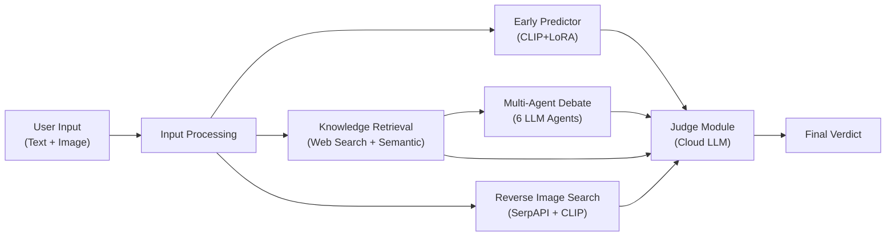
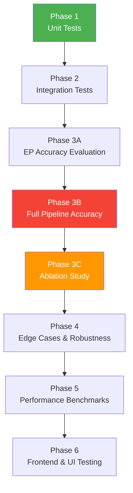

### **6 Testing Phases**

1. **Unit Tests** — Test each of your 6 modules in isolation (EP, Judge, KR, RIS, MAD, Input Processing)
2. **Integration Tests** — Verify the full pipeline flow and API endpoints
3. **Model Accuracy Evaluation** — The most critical phase for your FYP:
   - EP standalone accuracy (CLIP+LoRA baseline)
   - Full RAHMAD end-to-end accuracy
   - **Ablation study** — systematically disabling modules to prove each one's contribution
4. **Robustness Testing** — Adversarial inputs, satire detection, mixed signals, API resilience
5. **Performance Benchmarks** — Latency, memory usage, concurrency
6. **Frontend/UI Testing** — NDJSON streaming, verdict display, error handling

### **What Matters Most for Your FYP**

> The **ablation study** in Phase 3C is the strongest thing you can put in your evaluation chapter. It tests 7 different pipeline configurations (EP-only → Full RAHMAD) to prove that each module — Knowledge Retrieval, Reverse Image Search, Multi-Agent Debate — adds measurable accuracy improvement.

Please review the plan and let me know if you'd like to proceed with implementing any of these phases, or if you'd like to adjust the scope.

# RAHMAD — Comprehensive Testing Plan

## System Architecture Overview

The RAHMAD pipeline has **6 core modules** to test:

| #   | Module                     | File                                   | Type                  |
| --- | -------------------------- | -------------------------------------- | --------------------- |
| 1   | Input Processing           | `input_processing.py`                  | Deterministic         |
| 2   | Early Predictor (EP)       | `early_predictor.py`                   | ML Model              |
| 3   | Knowledge Retrieval (KR)   | `knowledge_retrieval.py`               | External API + NLP    |
| 4   | Reverse Image Search (RIS) | `reverse_image_search.py`              | External API + Vision |
| 5   | Multi-Agent Debate (MAD)   | `mad_orchestrator.py` + `mad_agent.py` | LLM Multi-Agent       |
| 6   | Judge Module               | `judge.py`                             | LLM Reasoning         |
| 7   | End-to-End Pipeline        | `analyzer.py`                          | Integration           |

---

## Phase 1 — Unit Testing (Module-Level)

> [!IMPORTANT]
> Unit tests verify each module in isolation. These can run without external API calls by using mocked responses where needed.

### 1.1 Input Processing (`backend/input_processing.py`)

**What to test:** Text cleaning, lead text extraction, CLIP tokenization, image processing.

| Test Case                                   | Input                                          | Expected Output                                                   | Assertion                                   |
| ------------------------------------------- | ---------------------------------------------- | ----------------------------------------------------------------- | ------------------------------------------- |
| `clean_for_llm` — normal article            | Multi-paragraph news article with URLs, emails | URLs replaced with `<URL>`, emails with `<EMAIL>`, text preserved | Output contains `<URL>`, no raw URLs remain |
| `clean_for_llm` — Unicode handling          | Text with unicode chars (é, ñ, ü, 中文)        | Transliterated to ASCII                                           | No non-ASCII chars in output                |
| `clean_for_llm` — empty string              | `""`                                           | `""`                                                              | Empty string returned                       |
| `extract_and_clean_lead_text` — normal      | Multi-line article                             | First 2 non-empty lines, lowercased                               | Output is lowercase, single line            |
| `extract_and_clean_lead_text` — single line | One-liner headline                             | That line, cleaned & lowercased                                   | Lowercase, no crash                         |
| `tokenize_text` — output shape              | Any cleaned text                               | `input_ids: [1, 77]`, `attention_mask: [1, 77]`                   | Tensor shapes match                         |
| `tokenize_text` — long text truncation      | 500-word text                                  | Truncated to 77 tokens                                            | `input_ids.shape[1] == 77`                  |
| `process_image` — output shape              | Any RGB PIL image                              | `pixel_values: [1, 3, 224, 224]`                                  | Tensor shape matches                        |
| `process_image` — grayscale input           | Grayscale PIL image                            | Converted to 3-channel                                            | No crash, correct shape                     |
| `preprocess_inputs` — full pipeline         | Text + image                                   | Dict with all 5 keys                                              | All keys present, correct types             |

### 1.2 Early Predictor (`model/early_predictor.py`)

**What to test:** Model loading, inference, verdict thresholds, text cleaning.

| Test Case                              | Input                           | Expected Output                            | Assertion               |
| -------------------------------------- | ------------------------------- | ------------------------------------------ | ----------------------- |
| `_clean_text_for_clip` — HTML removal  | `"<b>Breaking</b> news"`        | `"breaking news"`                          | No HTML tags, lowercase |
| `_clean_text_for_clip` — URL removal   | Text with `https://example.com` | URL removed                                | No URLs in output       |
| `_clean_text_for_clip` — emoji removal | Text with 🚨📰                  | Emojis removed                             | No emoji chars          |
| `_clean_text_for_clip` — non-string    | `None`, `123`                   | `""`                                       | Returns empty string    |
| `_build_verdict` — high fake (p=0.85)  | `probability=0.85`              | `label="FAKE"`, `pass_to_agents=True`      | Correct label           |
| `_build_verdict` — high real (p=0.15)  | `probability=0.15`              | `label="REAL"`, `pass_to_agents=True`      | Correct label           |
| `_build_verdict` — uncertain (p=0.50)  | `probability=0.50`              | `label="UNCERTAIN"`, `pass_to_agents=True` | Correct label           |
| `_build_verdict` — boundary (p=0.60)   | `probability=0.60`              | `label="FAKE"`                             | Threshold is `>=`       |
| `_build_verdict` — boundary (p=0.40)   | `probability=0.40`              | `label="REAL"`                             | Threshold is `<=`       |
| `predict` — known fake article         | Known fake text + image         | `probability > 0.5`                        | Directionally correct   |
| `predict` — known real article         | Known real text + image         | `probability < 0.5`                        | Directionally correct   |
| Model loading — artifacts exist        | Valid artifact paths            | Model loads without error                  | No exception            |
| Model loading — missing artifacts      | Invalid paths                   | `FileNotFoundError` raised                 | Correct error type      |

### 1.3 Judge Module (`model/judge.py`)

**What to test:** Response parsing, verdict normalization, text sanitization, fallback handling.

| Test Case                                 | Input                          | Expected Output                               | Assertion                   |
| ----------------------------------------- | ------------------------------ | --------------------------------------------- | --------------------------- |
| `_parse_response` — clean JSON            | Valid JSON string              | Parsed dict with all fields                   | All required keys present   |
| `_parse_response` — markdown fences       | `json {...} `                  | Same as clean JSON                            | Parsed correctly            |
| `_parse_response` — `<think>` blocks      | `<think>...</think>{...}`      | Think block stripped, JSON parsed             | Correct parsing             |
| `_parse_response` — truncated JSON        | JSON cut off mid-string        | Auto-repaired and parsed                      | No crash, best-effort parse |
| `_parse_response` — verdict normalization | `"FABRICATED"`                 | `"FABRICATED CONTENT"`                        | Canonical verdict           |
| `_parse_response` — verdict normalization | `"CREDIBLE"`                   | `"CREDIBLE"`                                  | Canonical verdict           |
| `_parse_response` — verdict normalization | `"REAL NEWS"`                  | `"CREDIBLE"`                                  | Maps to CREDIBLE            |
| `_parse_response` — unknown verdict       | `"BOGUS VERDICT"`              | `"INCONCLUSIVE"`                              | Falls back safely           |
| `_clean_user_facing_text` — MAD acronym   | `"MAD shows..."`               | `"Multi-Agent Debate shows..."`               | Acronym replaced            |
| `_clean_user_facing_text` — RIS acronym   | `"RIS module indicates..."`    | `"Reverse Image Search indicates..."`         | Acronym replaced            |
| `_clean_user_facing_text` — KR acronym    | `"According to KR"`            | `"According to external news reports"`        | Acronym replaced            |
| `_parse_confidence_float` — `"87.0%"`     | `"87.0%"`                      | `87.0`                                        | Correct float               |
| `_parse_confidence_float` — invalid       | `"N/A"`                        | `50.0`                                        | Fallback value              |
| `_aggregate_verdicts` — majority vote     | 3 results (2 CREDIBLE, 1 FAKE) | `"CREDIBLE"`                                  | Majority wins               |
| `_fallback_response` — error              | Any error string               | `verdict="INCONCLUSIVE"`, `confidence="0.0%"` | Safe fallback               |

### 1.4 Knowledge Retrieval (`model/knowledge_retrieval.py`)

| Test Case                                   | Input                                                | Expected Output          | Assertion              |
| ------------------------------------------- | ---------------------------------------------------- | ------------------------ | ---------------------- |
| `is_social_media_url` — Facebook            | `https://facebook.com/post/123`                      | `True`                   | Filtered out           |
| `is_social_media_url` — Reuters             | `https://reuters.com/article`                        | `False`                  | Not filtered           |
| `filter_domains` — mixed URLs               | Mix of whitelisted + non-whitelisted                 | Only whitelisted survive | Count matches expected |
| `extract_title_from_url_slug` — normal slug | `https://reuters.com/world/asia-flood-disaster-2024` | Readable title string    | Non-empty, readable    |
| `semantic_filter` — high similarity         | Claim + very relevant article                        | Snippets returned        | `len(snippets) > 0`    |
| `semantic_filter` — low similarity          | Claim + unrelated article                            | Empty or filtered        | `len(snippets) == 0`   |
| `semantic_filter` — embedder not loaded     | `self.embedder = None`                               | Raw text fallback        | Returns raw chunks     |

### 1.5 Multi-Agent Debate (`model/mad_orchestrator.py` + `model/mad_agent.py`)

| Test Case                          | Input                     | Expected Output               | Assertion                          |
| ---------------------------------- | ------------------------- | ----------------------------- | ---------------------------------- |
| `assign_profiles` — valid response | Topic summary             | List of 6 profile strings     | `len(profiles) == 6`               |
| `assign_profiles` — LLM failure    | Force exception           | Fallback 6 profiles           | Uses hardcoded fallbacks           |
| Agent initialization               | Name, side, profile, role | Agent with correct attributes | All attributes set                 |
| Debate structure                   | Run `run_debate()`        | 3 stages, 2 agents per stage  | 6 total arguments in shared memory |
| Shared memory                      | Add arguments             | Formatted history string      | All arguments in history           |

---

## Phase 2 — Integration Testing

> [!TIP]
> Integration tests verify that modules work correctly together. These require API access but can use controlled inputs.

### 2.1 Pipeline Flow Tests

| Test Scenario                    | Configuration                 | What to Verify                                                   |
| -------------------------------- | ----------------------------- | ---------------------------------------------------------------- |
| **Full pipeline (text + image)** | All modules enabled           | All 6 stages execute, result has all required keys               |
| **Text-only pipeline**           | No image provided             | EP skipped gracefully, RIS skipped, Judge still produces verdict |
| **Short text rejection**         | `< 10 chars`                  | Immediate INCONCLUSIVE, no modules invoked                       |
| **Judge mode: single**           | `JUDGE_MODE=single`           | Standard single-pass analysis                                    |
| **Judge mode: panel**            | `JUDGE_MODE=panel`            | 3 specialist judges + chief judge synthesis                      |
| **Judge mode: self_consistency** | `JUDGE_MODE=self_consistency` | 3 parallel runs + majority vote aggregation                      |
| **KR failure graceful**          | Block network for KR          | Pipeline continues, Judge gets empty KR context                  |
| **RIS failure graceful**         | Invalid SerpAPI key           | Pipeline continues, Judge gets empty RIS context                 |
| **MAD failure graceful**         | Force LLM timeout             | Pipeline continues, Judge gets empty MAD context                 |

### 2.2 API Endpoint Tests (`app.py`)

| Test             | Method | Endpoint       | Payload                                | Expected                                |
| ---------------- | ------ | -------------- | -------------------------------------- | --------------------------------------- |
| Valid request    | POST   | `/api/analyze` | `{"text": "...", "image": "data:..."}` | 200, NDJSON stream with status + result |
| Missing text     | POST   | `/api/analyze` | `{"image": "..."}`                     | 400, error JSON                         |
| Empty body       | POST   | `/api/analyze` | `{}`                                   | 400, error JSON                         |
| No image field   | POST   | `/api/analyze` | `{"text": "..."}`                      | 200, text-only analysis                 |
| Frontend serving | GET    | `/`            | —                                      | 200, HTML content                       |

---

## Phase 3 — Model Accuracy Evaluation (The Core FYP Test)

> [!IMPORTANT]
> This is the most critical testing phase for your FYP. It evaluates the actual classification accuracy of RAHMAD using established fake news datasets.

### 3.1 Dataset Selection

| Dataset                      | Source          | Size    | Labels       | Why Use It                            |
| ---------------------------- | --------------- | ------- | ------------ | ------------------------------------- |
| **FakeNewsNet (PolitiFact)** | GitHub          | ~1,000  | Real / Fake  | Gold standard, includes text + images |
| **FakeNewsNet (GossipCop)**  | GitHub          | ~22,000 | Real / Fake  | Large scale, entertainment domain     |
| **LIAR**                     | huggingface.co  | 12,836  | 6-way labels | Multi-class, political fact-checking  |
| **MediaEval FakeNews**       | MediaEval       | ~17,000 | Real / Fake  | Multimodal (text + image)             |
| **Custom Malaysian News**    | Manual curation | 50–100  | Real / Fake  | Domain-specific to your FYP context   |

### 3.2 Evaluation Metrics

For each test run, compute:

| Metric                 | Formula                 | What It Measures                                                  |
| ---------------------- | ----------------------- | ----------------------------------------------------------------- |
| **Accuracy**           | `(TP + TN) / Total`     | Overall correctness                                               |
| **Precision**          | `TP / (TP + FP)`        | Of predicted fakes, how many are truly fake                       |
| **Recall**             | `TP / (TP + FN)`        | Of actual fakes, how many were caught                             |
| **F1 Score**           | `2 × (P × R) / (P + R)` | Harmonic mean of precision and recall                             |
| **Confusion Matrix**   | 8×8 matrix              | Per-category performance (CREDIBLE, FABRICATED, MISLEADING, etc.) |
| **Cohen's Kappa**      | Agreement beyond chance | Inter-rater reliability vs ground truth                           |
| **Average Confidence** | Mean confidence score   | Calibration assessment                                            |

### 3.3 Testing Methodology

#### A. Early Predictor (EP) Standalone Accuracy

- **Goal:** Evaluate the CLIP+LoRA binary classifier in isolation
- **Method:** Run `ep.predict(text, image)` on each dataset sample
- **Mapping:** EP `probability >= 0.5` → FAKE, else → REAL
- **Metrics:** Accuracy, Precision, Recall, F1, AUC-ROC curve
- **Expected:** This is your baseline — the EP alone should already show reasonable binary classification

#### B. Full Pipeline (RAHMAD) Accuracy

- **Goal:** Evaluate the complete system's 8-class classification
- **Method:** Run `analyze_text(text, image)` end-to-end on each sample
- **Mapping:** Map RAHMAD's 8 verdicts to binary (CREDIBLE → Real, all others → Fake) for comparison with binary-labeled datasets
- **Metrics:** Full confusion matrix (8-class), binary accuracy, per-category precision/recall
- **Expected:** Should outperform EP alone due to retrieval augmentation and debate

#### C. Ablation Study (Critical for FYP!)

Test the system with modules disabled one-by-one to measure each module's contribution:

| Configuration             | EP  | KR  | RIS | MAD | Judge | Purpose                   |
| ------------------------- | --- | --- | --- | --- | ----- | ------------------------- |
| **EP Only**               | ✅  | ❌  | ❌  | ❌  | ❌    | Baseline CLIP+LoRA        |
| **Judge Only**            | ❌  | ❌  | ❌  | ❌  | ✅    | LLM text-only analysis    |
| **EP + Judge**            | ✅  | ❌  | ❌  | ❌  | ✅    | EP signal + LLM reasoning |
| **EP + KR + Judge**       | ✅  | ✅  | ❌  | ❌  | ✅    | + external knowledge      |
| **EP + KR + RIS + Judge** | ✅  | ✅  | ✅  | ❌  | ✅    | + visual verification     |
| **EP + KR + MAD + Judge** | ✅  | ✅  | ❌  | ✅  | ✅    | + debate reasoning        |
| **Full RAHMAD**           | ✅  | ✅  | ✅  | ✅  | ✅    | Complete pipeline         |

> [!NOTE]
> The ablation study is the strongest evidence for your FYP thesis — it proves that each module adds measurable value.

---

## Phase 4 — Robustness & Edge Case Testing

### 4.1 Adversarial / Edge Cases

| Test Case                                 | Input                                  | What It Tests                                    |
| ----------------------------------------- | -------------------------------------- | ------------------------------------------------ |
| **Pure satire** (e.g., The Onion article) | Satirical article                      | Can RAHMAD distinguish satire from fabrication?  |
| **Clickbait headline + factual body**     | Sensational headline, accurate body    | FALSE CONNECTION detection                       |
| **Real article, manipulated image**       | Legit text + doctored photo            | MANIPULATED CONTENT detection                    |
| **Imposter content**                      | Fake article mimicking Reuters format  | IMPOSTER CONTENT detection                       |
| **Very long article** (> 6000 chars)      | 10,000+ character article              | Truncation handling in Judge (`_MAX_TEXT_CHARS`) |
| **Non-English article**                   | Malay/Chinese news article             | Multilingual robustness                          |
| **All-caps article**                      | `"BREAKING: MASSIVE SCANDAL..."`       | Style analysis vs content analysis               |
| **Duplicate submission**                  | Same article submitted twice           | Consistency — same verdict both times?           |
| **Image with no text**                    | Only image, minimal text               | EP handles, Judge produces text-only verdict     |
| **Text with no image**                    | Only text, no image                    | EP skipped, text-only pipeline                   |
| **Mixed signals**                         | EP says REAL, but text is clearly fake | Does Judge override EP correctly?                |

### 4.2 API Resilience

| Test Case                  | What It Tests                            |
| -------------------------- | ---------------------------------------- |
| OpenRouter API down        | Judge fallback model chain works         |
| SerpAPI rate limited       | RIS handles gracefully                   |
| DuckDuckGo blocked         | KR fallback to Google News RSS / SerpAPI |
| LLM returns malformed JSON | `_parse_response` repair logic           |
| LLM returns truncated JSON | Auto-closing braces/brackets             |
| Network timeout            | All modules handle `timeout` exceptions  |

---

## Phase 5 — Performance Testing

| Metric                     | Target             | How to Measure                           |
| -------------------------- | ------------------ | ---------------------------------------- |
| **Total pipeline latency** | < 120s per article | `time.perf_counter()` (already logged)   |
| **EP inference time**      | < 5s               | Isolate EP prediction timing             |
| **KR retrieval time**      | < 15s              | Isolate KR pipeline timing               |
| **RIS search time**        | < 20s              | Isolate RIS pipeline timing              |
| **MAD debate time**        | < 60s              | Isolate MAD timing (3 rounds × 2 agents) |
| **Judge response time**    | < 30s              | Isolate Judge API call timing            |
| **Memory usage**           | < 4GB              | Monitor during full pipeline run         |
| **Concurrent requests**    | 2-3 simultaneous   | Stress test Flask with multiple requests |

---

## Phase 6 — Frontend / UI Testing

| Test                    | What to Verify                                 |
| ----------------------- | ---------------------------------------------- |
| Article submission form | Text and image upload work                     |
| Progress indicators     | Status updates stream correctly (NDJSON)       |
| Verdict display         | Correct color-coding for all 8 verdict types   |
| Reasoning panel         | CoT reasoning renders with markdown formatting |
| Key facts list          | Displays all key observations                  |
| Supporting links        | KR article links are clickable and valid       |
| EP signal display       | Early Predictor results shown transparently    |
| Responsive layout       | Works on desktop and mobile viewports          |
| Error handling          | Graceful UI when pipeline fails                |

---

## Recommended Testing Execution Order

> [!CAUTION]
> **Phase 3 (Accuracy Evaluation)** is the most important phase for your FYP. Start here if you have limited time. The ablation study (Phase 3C) is what will make your FYP evaluation section compelling.

---

## Test Dataset Preparation Checklist

- [ ] Curate at least **50 test articles** (25 real, 25 fake) with text + image pairs
- [ ] Include **all 7 misinformation categories** + credible articles
- [ ] Include articles from **different domains** (politics, health, science, entertainment)
- [ ] Ensure articles are **not in the EP training set** (no data leakage)
- [ ] Create a **CSV/JSON ground truth file** with columns: `id, text, image_path, true_label, category, domain`
- [ ] Optionally source from FakeNewsNet or LIAR for standardized benchmarking

---

## Output Artifacts to Collect

For each test run, save:

1. `output/output_log.txt` — Full pipeline log
2. `output/KR_output.txt` — Knowledge Retrieval forensic log
3. `output/RIS_output.txt` — Reverse Image Search forensic log
4. `output/MAD_output.txt` — Multi-Agent Debate log
5. `output/JUDGE_output.txt` — Judge reasoning and verdict log
6. **Confusion matrix** visualization
7. **Metrics summary** (accuracy, precision, recall, F1)
8. **Ablation comparison chart** showing accuracy across configurations
